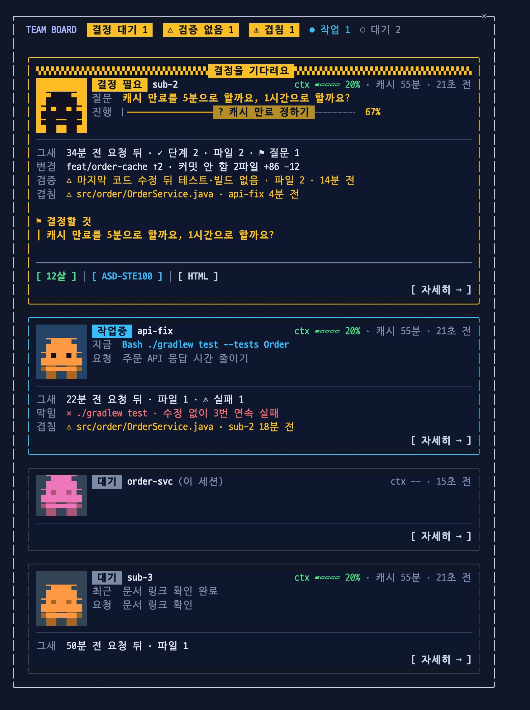
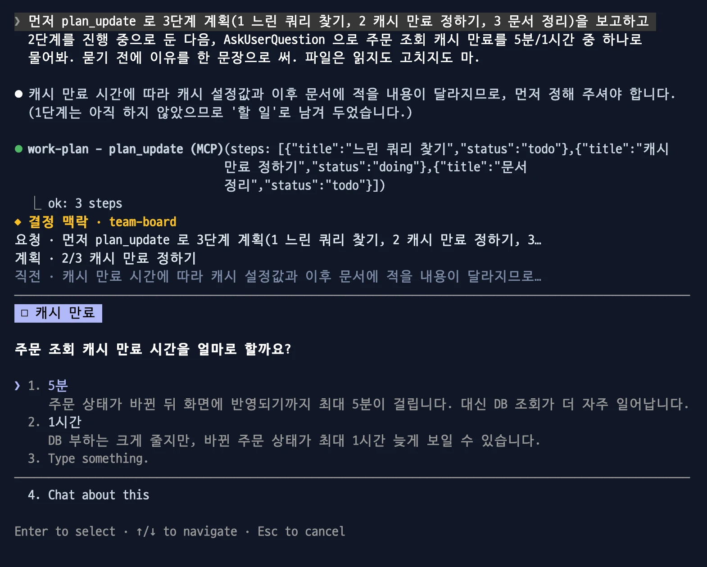
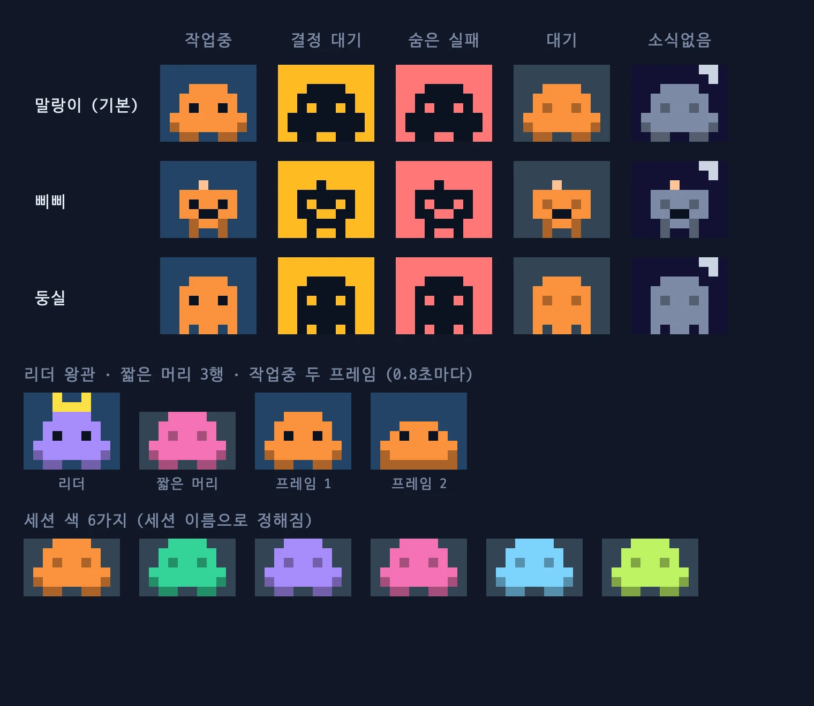
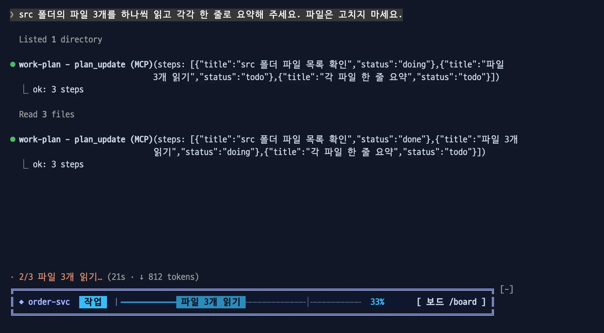
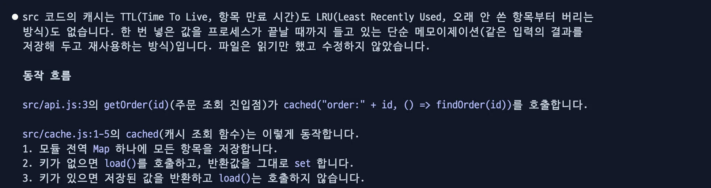
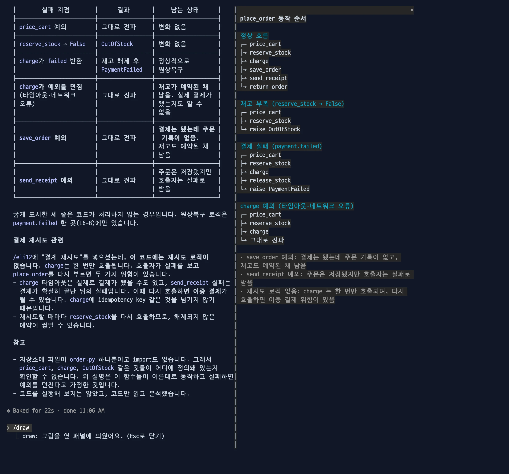
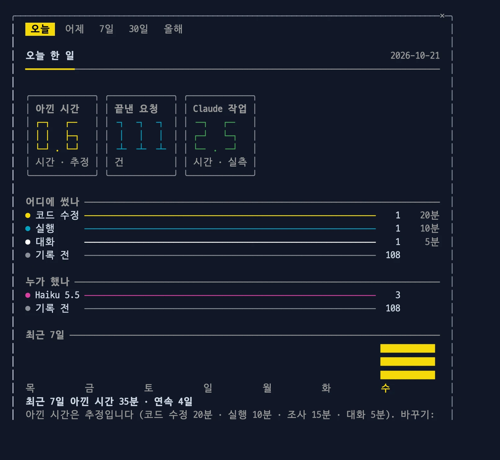
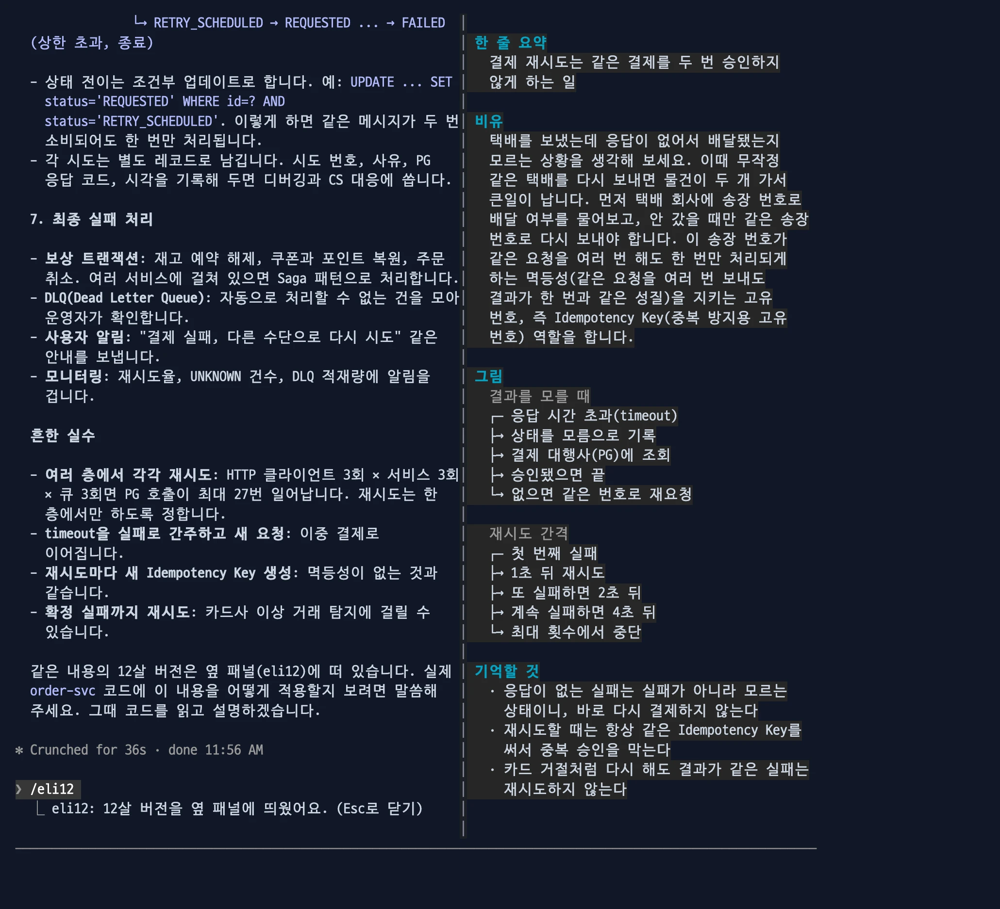
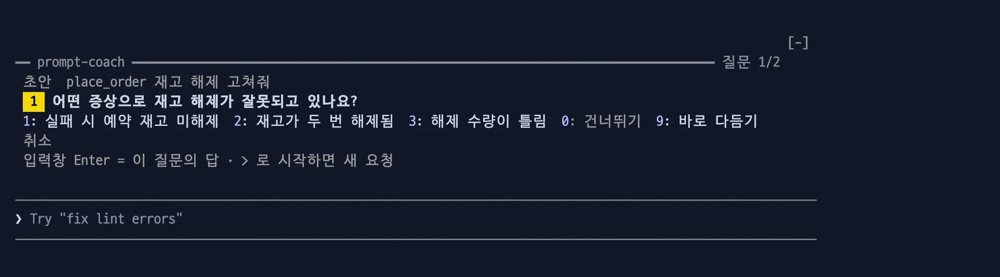

# devflow-mods

Claude Code mod 모음입니다. 여러 세션의 상황판, 작업 계획 보고, 용어 풀이, 흐름 그림, 기간별 돌아보기, 12살 버전 설명, 오해 없는 절차 글, 다음 요청 제안, 초안 다듬기를 제공합니다.

[](https://code.claude.com/docs/en/plugins/mods/overview)
[](LICENSE)

<p align="center">
  
</p>

## mod 목록

| | mod | 하는 일 | 명령 |
| :---: | --- | --- | --- |
| 🧭 | [**team-board**](#-team-board-팀-상황판) | 같은 저장소의 여러 세션을 한 화면에 보여 줍니다. 진행 현황, 결정 기록, 결정 대기 알림, 숨은 실패, 같은 파일 겹침, 프롬프트 캐시 남은 시간을 표시합니다. | `/board` |
| 📋 | [**work-plan**](#-work-plan-작업-계획-보고) | Claude가 여러 단계 작업의 계획과 진행을 보고합니다. team-board의 진행 막대가 이 보고로 채워집니다. | 없음 (도구 `plan_update`) |
| 🔤 | [**plain-terms**](#-plain-terms-용어-풀이) | Claude가 약어, 작업 번호, 코드 이름을 처음 쓸 때 괄호로 풀어 씁니다. | 없음 (규칙만) |
| 📐 | [**draw**](#-draw-흐름-그림) | 직전 답변의 흐름을 원문 낱말 그대로 옆 패널에 그림으로 보여 줍니다. | `/draw [낱말]` |
| 📅 | [**look-back**](#-look-back-돌아보기) | 오늘·어제·7일·30일·올해 동안 한 일을 보여 줍니다. 한눈에 숫자·차트(아낀 시간 추정, 종류·모델별)와 프로젝트별 요청, 결정, 커밋. | `/lookback [기간]` |
| 🧒 | [**eli12**](#-eli12-12살-버전-설명) | 어려운 설명을 12살 버전으로 풉니다. | `/eli12 [주제]` |
| 📏 | [**ste100**](#-ste100-오해-없는-절차-글) | 절차·지시·결정 항목을 ASD-STE100 에서 착안한 문체로 씁니다. | 없음 (스킬만) |
| 💡 | [**next-steps**](#-next-steps-다음-요청-제안) | 답변이 끝나면 다음 요청 2~3개를 제안합니다. | `/next [on\|off]` |
| 📝 | [**prompt-coach**](#-prompt-coach-초안-다듬기) | 보내기 전에 초안의 빈 곳을 묻고 다듬습니다. | `/coach <초안>\|view\|auto on\|off`, `[다듬기]`·`[되돌리기]` 버튼 |

| 설정 | mod | 바꾸는 곳 | 기본값 |
| --- | --- | --- | --- |
| 색 `palette` | team-board | `claude plugin configure team-board@devflow-mods` | `night` |
| 팀 창 켜기·끄기, 모양 | team-board | `/board band on\|off\|hud\|line`, `/board band solo off` | 켜짐, `hud` |
| 결정 대기 알림 (소리·OS 알림) | team-board | `/board sound on\|off\|test` | 켜짐. 음성은 macOS만, OS 알림은 `preferredNotifChannel` |
| 숨은 실패 감지 | team-board | `/board fail on\|off\|clear` | 켜짐 |
| 세션 표시 이름 | team-board | `/board name <이름>` | 세션 이름 → 브랜치 → 폴더 |
| 카드 캐릭터 | team-board | `/board 캐릭터 말랑이\|삐삐\|둥실\|섞기` | 말랑이 |
| 다른 mod보다 앞에 두기 | team-board | `~/.claude/settings.json` 의 `prependPlugins` | 없음 |
| 작업 계획 보고 | work-plan | `claude plugin disable work-plan@devflow-mods` | 켜짐 |
| 계획 전 수정 막기 `planGate` | work-plan | `claude plugin configure work-plan@devflow-mods` | 꺼짐 |
| 용어 풀이 | plain-terms | `claude plugin disable plain-terms@devflow-mods` | 켜짐 |
| 다음 요청 제안 | next-steps | `/next on\|off` | 켜짐 |
| 보낼 때마다 다듬기 | prompt-coach | `/coach auto on\|off` (모든 세션) | 꺼짐 |

## 필요한 것

| 항목 | 필요 여부 | 내용 |
| --- | --- | --- |
| Claude Code | 필수 | v2.1.311 이상을 권장합니다(실제로 돌려 확인한 버전). v2.1.295 미만에서는 상황판·패널이 그려지지 않으니 그 이상을 쓰세요. `claude --version` 으로 확인하세요. |
| git | 선택 (team-board) | 카드의 `변경` 줄과 워크트리 브랜치 이름을 읽습니다. 없거나 git 저장소가 아니면 그 줄만 빠집니다. |
| 알림 소리 명령 | 선택 (team-board) | macOS 는 따로 설치할 것이 없습니다. Linux 는 `paplay`(PulseAudio) 또는 `aplay`(ALSA), Windows 는 PowerShell 로 소리를 냅니다. 없으면 소리만 나지 않습니다. |
| `date` 명령 | 선택 (look-back) | 시스템 시간대를 읽어 날짜를 나눕니다. 없으면(Windows 기본 셸 등) UTC 기준으로 나눕니다. |

- 설치되는 최소 버전(2.1.290)은 버전마다 `claude plugin validate` 로 모든 mod 를 검사해 정했습니다(2.1.286 ~ 2.1.312, 2026-10-28). 2.1.289 이하는 next-steps 를 거부하고, 나머지 mod 는 2.1.286 부터 통과합니다. 이 검사는 Claude Code 가 mod 를 받아 주는지만 보며, 결과 값이 비거나 동작이 다른 것은 잡지 못합니다.
- 그래서 버전마다 각 mod 의 테스트(`claude plugin test`)도 돌렸습니다(2026-10-29). 2.1.300 이상은 모두 통과합니다. 2.1.295 ~ 2.1.299 는 team-board 의 보조 에이전트 대화 보기([보기])만 안 되고 나머지는 통과합니다. 2.1.294 이하는 글자를 품은 버튼이 있는 화면 전체를 Claude Code 가 그리지 않아 team-board·look-back·next-steps·prompt-coach 화면이 비고, 2.1.290 은 결정 대기 알림(`ui.notify`)도 없습니다. 데스크톱 앱에 들어 있는 Claude Code 는 2.1.308 이었습니다(이 기계, 2026-10-29).
- 실제 화면 확인은 macOS 터미널, Claude Code 2.1.311 ~ 2.1.312 에서 했습니다. 데스크톱 앱 Code 탭에서도 mod 가 뜨는 것을 확인했습니다(2026-10-22). Linux·Windows 는 아직 실제로 확인하지 못했습니다.
- mod 가 쓰는 Claude Code 기능은 아직 미리 보기 단계(EARLY ACCESS)라 새 버전에서 바뀔 수 있습니다. 새 버전에서 이상하면 [이슈](https://github.com/yeochul-jeon/devflow-mods/issues)로 알려 주세요.
- tmux 는 필요 없습니다. tmux·python3 은 개발용 도구(`docs/tools`, 실화면 확인·스크린샷)만 씁니다.

## 설치

```bash
claude plugin marketplace add yeochul-jeon/devflow-mods#stable
claude plugin install team-board@devflow-mods
claude plugin install work-plan@devflow-mods      # 요청마다 약 560 토큰 (team-board와 함께 쓰세요)
claude plugin install plain-terms@devflow-mods    # 대화 첫 요청에 규칙 약 280 토큰, 답변이 조금 길어집니다
claude plugin install draw@devflow-mods           # /draw 할 때만 Haiku를 호출합니다
claude plugin install look-back@devflow-mods      # 기록은 토큰 0, [요약] 누를 때만 Haiku를 호출합니다
claude plugin install eli12@devflow-mods
claude plugin install ste100@devflow-mods          # 별도 모델 호출 없음. 스킬이 발동할 때만 스킬 본문이 대화에 들어갑니다
claude plugin install next-steps@devflow-mods     # 답변마다 Haiku를 호출합니다
claude plugin install prompt-coach@devflow-mods   # 다듬을 때 Haiku 2회. 자동 모드(기본 꺼짐)면 보낼 때마다
```

- `#stable` 은 릴리즈된 버전만 받습니다. 버전마다 변경 내역은 [Releases](https://github.com/yeochul-jeon/devflow-mods/releases) 에 있습니다. `#stable` 없이 추가하면 main 의 개발 중 버전을 받습니다.
- 필요한 mod만 설치하세요.
- 회사가 관리하는 Claude Code(Team·Enterprise)에서 쓰면 [점검 5단계](docs/enterprise-check.md)로 team-board 와 work-plan 이 도는지 확인해 주세요. 아직 그 환경에서 확인하지 못했습니다.
- team-board는 사용자 범위(기본)로 설치하세요. 모든 세션과 워크트리에서 보여야 하기 때문입니다.
- 한 프로젝트에만 쓰려면 그 프로젝트 폴더에서 `--scope local` 을 붙이세요.
- 설치 중 `1 userConfig option not yet set` 이 보이면 `palette` 를 고르지 않은 상태입니다. 그대로 두면 `night` 로 동작합니다.
- 설치한 뒤 열려 있는 Claude Code를 `/exit` 하고 다시 시작하세요. `claude --continue` 로 대화를 이어서 엽니다.

<details>
<summary>업데이트·삭제</summary>

```bash
claude plugin marketplace update devflow-mods
claude plugin update team-board@devflow-mods      # mod마다 실행합니다
claude plugin uninstall team-board@devflow-mods   # 삭제
```

업데이트한 뒤 세션을 다시 열어야 새 버전이 적용됩니다.

`#stable` 없이 추가했다면 아래처럼 옮깁니다. `marketplace remove` 는 그 mod 들도 지우므로 다시 설치합니다.

```bash
claude plugin marketplace remove devflow-mods
claude plugin marketplace add yeochul-jeon/devflow-mods#stable
claude plugin install team-board@devflow-mods     # 쓰던 mod마다 실행합니다
```

릴리즈하는 쪽은 main 에 커밋·push 하고 실화면을 확인한 뒤 `docs/tools/release.sh <mod>` 를 돌립니다. 태그 `<mod>--v<버전>`, Release(본문은 CHANGELOG), stable 목록의 그 mod 항목을 한 번에 바꿉니다. 중간에 실패하면 다시 돌리면 남은 단계만 합니다. 태그가 다른 커밋을 가리키면 아무것도 하지 않고 멈춥니다.

</details>

> [!WARNING]
> mod는 Claude Code와 같은 권한으로 내 컴퓨터에서 실행됩니다. 설치 전에 코드를 읽으세요. `claude plugin validate ./team-board` 는 mod를 실행하지 않고 받는 이벤트와 호출을 보여 줍니다.

---

## 🧭 team-board: 팀 상황판


같은 저장소에서 실행 중인 Claude Code 세션을 모두 보여 줍니다. 워크트리도 포함합니다.

- **팀 창**: 입력창 위에 세션마다 칸을 그립니다. 칸은 상태, 진행 막대, 결정 대기 질문, 숨은 실패를 보여 줍니다. 진행 막대는 채움 선 끝에 지금 단계 이름 칩을 붙이고(`▏━━━━ 테스트 실행 ╌╌│╌╌│╌╌  40%`), 멈춘 세션은 노란 `멈춤: <단계>`, 끝나면 걸린 시간(`✓ 3분 12초`)을 보입니다. 칸이 좁으면 예전 경로선 `●━◉─○─◎` 으로 그립니다.
- **지금 단계 줄**: 턴이 도는 동안 입력창 바로 위 줄(`✻ Sauteing… (12s)`)을 지금 단계 `2/5 테스트 실행… (12s)` 로 바꿉니다. 엔진이 권한 대기 같은 자기 문구를 띄우면 그대로 둡니다.
- **보드**: `/board` 는 세션별 요청, 진행, 결정 기록을 보여 줍니다. 카드 왼쪽 픽셀 캐릭터는 바탕색으로 상태를, 몸 색으로 세션을 보이고, 다른 세션에 일을 맡긴 리더 세션은 왕관을 씁니다. 결정 대기 항목을 12살 버전·ASD-STE100 기준 탭으로 설명하고, HTML 페이지(Artifact)를 요청할 수 있습니다.
- **숨은 실패**: exit 0으로 끝났지만 출력에 실패 흔적이 있는 빌드·테스트를 찾습니다. Claude와 모든 탭에 알립니다.
- **결정 대화상자 위 맥락**: Claude 가 AskUserQuestion 으로 물을 때 대화상자 위에 요청·지금 계획 단계·직전 글을 몇 줄로 보입니다.
- **검증 없음**: 코드를 고친 뒤 테스트·빌드를 돌리지 않고 턴이 끝나면 `/board` 카드에 `검증  △ …` 줄을 보입니다.
- **같은 실패 반복**: 코드를 고치지 않고 같은 명령이 3번 연속 실패하면 Claude 에게 한 줄 알리고 `/board` 카드에 `막힘` 줄을 보입니다.
- **같은 파일 겹침**: 같은 저장소의 두 세션이 1시간 안에 같은 파일을 고치면 `/board` 카드에 `겹침` 줄을 보이고, 나중에 고친 세션의 Claude에게 한 번 알립니다.
- **결정 대기 알림**: 세션이 결정을 20초 넘게 기다리면 소리로 알립니다. chime 은 macOS, Windows(PowerShell), Linux(`paplay` 또는 `aplay`)에서 울리고, 음성 안내는 macOS에서만 나옵니다. Windows·Linux 는 실기에서 확인하지 않았습니다.
- **캐시 남은 시간**: 프롬프트 캐시가 10분 이하로 남으면 칸에 표시합니다.
- **보조 에이전트**: 세션이 띄운 서브에이전트가 몇 개 돌고 몇 개 끝났는지 팀 창 머리줄(`보조 n`)과 카드에 보여 줍니다. 카드에는 진행 막대 아래 보조마다 한 줄(`↳ 1 결제 테이블 조사 (haiku 5.5)  Grep  12초`)이 붙고, 넘치면 `↳ +2 보조 2개 · 2개 끝남` 으로 줄입니다. `/board <세션>` 목록에는 종류·모델·지금 도구·경과·토큰이 나오고, 토큰은 보조가 끝난 뒤 엔진이 센 수입니다. 백그라운드로 맡겨 둔 세션과 멈춘 세션을 구별할 수 있습니다. 턴은 끝났지만 보조가 아직 도는 세션은 `대기` 가 아니라 `보조` 배지와 `보조 n개 기다리는 중` 으로 보입니다. 모델 호출이 없어 토큰이 들지 않습니다.

| 명령 | 동작 |
| --- | --- |
| `/board` | 모든 세션을 보여 줍니다. |
| `/board <세션>` | 한 세션의 할 일, 결정 기록, 흐름, 최근 편집 파일을 보여 줍니다. |
| `/board fail` | 숨은 실패 보고서를 보여 줍니다. |
| `/board 캐릭터 말랑이\|삐삐\|둥실\|섞기` | 카드 왼쪽 캐릭터를 바꿉니다. `섞기` 는 세션마다 캐릭터와 색을 다르게 합니다. |
| `/board help` | 모든 명령과 예시를 보여 줍니다. |

### 용도별 사용 예

**1. 여러 세션 중 결정을 기다리는 세션 찾기**

세션을 여러 개 돌리면 어느 세션이 내 답을 기다리는지 놓치기 쉽습니다. 입력창 위 팀 창에서 노란 ` 결정 ` 칸을 찾으세요. 질문 앞부분이 칸에 보입니다(절 맨 위 그림의 sub-2). `/board` 를 열면 결정 대기 세션이 맨 위에 옵니다.

**2. 결정이 어려울 때 설명 받기**

결정 대기 카드의 탭을 누르면 Haiku가 그 질문을 풀어 설명합니다. `12살` 은 비유와 선택지별 흐름 그림, `ASD-STE100` 은 "X를 고르면 Y가 일어납니다" 꼴의 짧은 문장입니다. 설명을 다시 받으려면 탭 옆 `↻` 를, 페이지로 보려면 `[ HTML ]` 을 누르세요.


**3. 보조 에이전트에 맡겨 둔 세션 구별하기**

턴은 끝났지만 서브에이전트가 아직 도는 세션은 ` 대기 ` 가 아니라 ` 보조 ` 배지와 `보조 n개 기다리는 중` 으로 보입니다. `/board <세션>` 에서 에이전트마다 하는 일, 지금 도구, 경과 시간, 끝난 뒤 토큰을 봅니다.


**4. 성공처럼 끝난 실패 찾기**

`./gradlew test 2>&1 | tail -20` 처럼 파이프 때문에 exit 0 으로 끝났지만 출력에 실패가 있으면 카드가 빨갛게 바뀝니다. Claude에게도 알려서 성공이라고 보고하지 않게 합니다.


**4-1. 돌아와서 무엇이 바뀌었나, 믿어도 되나 보기**

카드에 `경과`(마지막 요청 뒤 끝난 단계·고친 파일·질문·실패), `변경`(브랜치와 커밋 안 한 변경), `검증`(코드를 고친 뒤 테스트·빌드 없음), `막힘`(같은 명령 3번 연속 실패), `겹침`(두 세션이 같은 파일을 고침) 줄이 생깁니다. 막힘과 겹침은 Claude에게도 한 줄 알립니다.



Claude가 AskUserQuestion으로 물으면 대화상자 위에 요청·지금 계획 단계·직전 이유가 보입니다.



**5. 한 세션의 흐름을 되짚고 원문 복사하기**

`/board sub-3` 은 할 일, 결정 기록(질문 → 답), 흐름(요청 → 질문 → 결정 → 완료)을 시간 순으로 보여 줍니다. 흐름 줄을 누르면 그 원문 전체가 클립보드에 복사됩니다. 다른 세션에 같은 요청을 다시 보낼 때 씁니다.


**6. 좁은 패널에서 보기**

Orca 도크처럼 좁은 패널에서는 카드 머리줄이 덜 중요한 것(ctx 막대, 몇 초 전, 캐시)부터 덜어 내 한 줄을 지킵니다. 탭 줄은 탭 단위로 줄을 바꿉니다.


**7. 카드 캐릭터로 세션과 상태 알아보기**

`/board` 카드 왼쪽의 픽셀 캐릭터는 두 가지를 한 번에 보여 줍니다. **바탕색은 상태**(옅은 파랑 작업중 · 노랑 결정 대기 · 빨강 숨은 실패 · 회색 대기 · 어두움 소식없음), **몸 색은 세션**입니다. 몸 색은 세션 이름으로 정해져서 같은 세션은 늘 같은 색입니다.



- 결정 대기와 숨은 실패는 경고가 먼저 보이도록 어두운 실루엣으로 바뀝니다. 소식없음은 눈을 감고 오른쪽 위에 z 를 띄웁니다.
- 메인 대화가 일하는 동안만 0.8초마다 두 프레임을 오갑니다. 보조 에이전트만 기다리는 세션은 멈춰 있습니다.
- **왕관은 리더입니다.** 보드에 있는 다른 세션에 `SendMessage` 로 일을 맡긴 세션이 그 팀메이트가 보드에 있는 동안 왕관을 씁니다. 맡은 쪽이 보내는 결과 보고는 리더로 치지 않습니다. 팀메이트 세션이 없으면 보조 에이전트가 도는 동안만 씁니다.
- 캐릭터는 말랑이(기본)·삐삐·둥실 3종입니다. `/board 캐릭터 둥실` 처럼 바꾸면 다음 세션에도 유지됩니다. `/board 캐릭터 섞기` 는 세션마다 캐릭터와 색을 다르게 정해(18 조합) 세션을 구별하기 쉽게 합니다.
- 머리가 짧은 카드(왕관 없이 3줄 미만)는 타일을 3행으로 줄여 빈 줄을 덜 만듭니다. 56칸보다 좁은 패널, 데스크톱 앱, `theme` 팔레트에서는 캐릭터 없이 글자 배지만 보입니다.

팀 창 모양, 세션 이름, 카드 기호, 숨은 실패 판정 규칙, 기록하는 내용은 [docs/team-board.md](docs/team-board.md)를 보세요.

---

## 📋 work-plan: 작업 계획 보고

- Claude가 여러 단계 작업의 계획과 진행을 `plan_update` 도구로 보고합니다. team-board가 이 보고로 진행 막대와 지금 단계 줄을 그립니다.



- Opus 5.5 같은 새 모델에는 할 일 도구(TodoWrite, TaskCreate)가 없어 진행 막대가 비어 있습니다. 이 mod가 그 자리를 채웁니다.
- 혼자 설치하면 화면에 보이는 것이 없습니다. team-board와 함께 설치하세요.
- 보고는 모델이 하므로 짧은 작업에서는 빠질 수 있습니다.

- 비용: 요청마다 도구 설명 약 560 토큰이 들어갑니다. 보고는 작업 도구와 같은 응답에 실려 요청 수는 늘지 않았습니다(3단계 작업 2회 측정, API 환산 +22%).
- 선택: `planGate` 를 켜면 한 턴에서 계획을 보고하기 전의 파일 수정(Edit, Write, NotebookEdit)을 거부합니다. 기본은 꺼짐입니다.

동작, 조직 관리 환경(Team, Enterprise)에서의 제약, 알아둘 것은 [work-plan/README.md](work-plan/README.md)를 보세요.

---

## 🔤 plain-terms: 용어 풀이

- Claude가 답변에서 약어(`tsc`), 작업 번호(`T6`), 코드 이름(`scanGen`)을 처음 쓸 때 괄호로 짧게 풀어 씁니다. 예: `tsc(TypeScript 타입 검사기)`



- 화면에 그리는 것은 없습니다. 혼자 설치해도 동작합니다.
- 효과: 처음 나온 용어 중 풀이가 붙은 비율이 시험 프롬프트 5개에서 44.9% → 81.1% 로 올랐습니다. 평소 답변 20개의 기준값은 20.8% 였습니다.
- 비용: 대화 첫 요청에 규칙 약 280 토큰. 요청 수는 늘지 않았고 답변은 평균 11.5% 길어졌습니다.

측정 방법과 알아둘 것은 [plain-terms/README.md](plain-terms/README.md)를 보세요.

---

## 📐 draw: 흐름 그림

- `/draw` 는 직전 답변에 든 흐름(작업 순서, 호출 경로, 갈래)을 옆 패널에 그림으로 보여 줍니다. `/draw <낱말>` 은 그 낱말에 관한 흐름만 그립니다.
- 상자 이름은 원문 낱말과 식별자를 그대로 씁니다. 설명을 쉽게 바꾸는 것은 `/eli12` 입니다.
- 효과: 실제 긴 답변 10개에서 상자 이름 99.3% 가 원문 낱말이었고, 9/10 이 원문 단계를 빠뜨리지 않았습니다(2회 측정).
- 비용: 실행마다 Haiku 1회. 메인 대화 요청은 늘지 않습니다. Esc로 패널을 닫습니다.



측정 방법과 알아둘 것은 [draw/README.md](draw/README.md)를 보세요.

---

## 📅 look-back: 돌아보기

- `/lookback [오늘|어제|7일|30일|올해]` 은 그 기간 동안 프로젝트별로 Claude에게 보낸 요청(결과, 걸린 시간), 내린 결정(team-board 기록), 그 저장소의 커밋 제목을 옆 패널에 보여 줍니다.
- 대화형 세션의 사람 요청만 기록합니다. 설치한 뒤부터 쌓입니다.
- 비용: 기록과 보기는 토큰 0입니다. 프로젝트의 `[요약]` 을 누를 때만 Haiku 1회.
- 패널 맨 위 "한눈에" 칸(Work Report): 아낀 시간(추정)·끝낸 요청·Claude 작업 시간 타일, 어디에 썼나(코드 수정·실행·조사·대화), 누가 했나(모델), 3줄 차트, 연속 일수. `/lookback report off` 로 숨깁니다.



저장 위치와 알아둘 것은 [look-back/README.md](look-back/README.md)를 보세요.

---

## 🧒 eli12: 12살 버전 설명

- 자동 스킬 `explain-simply` 는 어려운 설명에만 비유와 그림을 넣습니다.
- `/eli12` 는 직전 답변을 옆 패널에 12살 버전으로 풉니다.
- `/eli12 바운디드 컨텍스트` 는 그 부분만 풉니다. 직전 답변이 없으면 주제 자체를 설명합니다.
- 그림은 Haiku 가 준 단계로 mod 가 직접 그려서 한글 줄에서도 상자가 어긋나지 않습니다.
- 비용: 실행마다 Haiku 1회. 메인 대화 요청은 늘지 않습니다. Esc로 패널을 닫습니다.



자세한 동작은 [eli12/README.md](eli12/README.md)를 보세요.

---

## 📏 ste100: 오해 없는 절차 글

- 자동 스킬 `write-unambiguous` 는 읽는 사람이 그대로 실행하거나 결정할 글에만 적용합니다. 예: 런북, 인계할 일, 칠 명령, 고를 선택지.
- 한 문장에 지시 하나, 조건 먼저, 같은 대상은 같은 이름, 세로 목록, 비유 없음.
- ASD-STE100 규격 원문과 대조하지 않은 규칙이라 "ASD-STE100 에서 착안(80%)" 이라고 부릅니다.
- eli12 는 비유로 이해시키고, ste100 은 비유 없이 잘못 읽지 않게 합니다.
- 비용: 별도 모델 호출 없음.

자세한 규칙은 [ste100/README.md](ste100/README.md)를 보세요.

---

## 💡 next-steps: 다음 요청 제안

- 답변이 끝나면 입력창 위에 `다음: 1: … 2: … 3: …` 을 보여 줍니다. 목록 위의 흐린 가로줄 `── next-steps ──`이 위 대화와 목록을 나눕니다.
- 빈 입력창에서 숫자를 누르면 그 요청이 초안으로 들어갑니다. 고치거나 Enter로 보내세요. 자동으로 보내지 않습니다.
- 숫자는 목록이 화면에 보일 때만 동작합니다. 위의 다른 영역(Claude Code 의 Heads up 안내 등)에 숫자 버튼이 있으면 숫자는 그 영역의 것이고, 목록은 클릭으로 고릅니다. 이때 안내 줄이 `클릭으로 고르기` 로 바뀝니다.
- 제안 줄을 클릭하면 그 요청이 입력창의 커서 자리에 들어갑니다. 쓰던 글은 남습니다. 마우스를 올린 줄에는 음영이 생깁니다. 클릭은 fullscreen 터미널에서만 동작합니다.
- `0` 은 목록을 닫습니다.
- 제안은 대화 언어를 따릅니다. 파일 이름, 명령, 식별자는 그대로 둡니다.
- `/next` 는 이번 세션 사용량을 보여 줍니다. `/next off` 와 `/next on` 은 다음 세션에도 유지됩니다.


그림과 사용 예는 [next-steps/README.md](next-steps/README.md)를 보세요.

<details>
<summary>비용과 주의</summary>

- 메인 스레드의 답변이 끝날 때마다 Haiku를 1회 호출합니다.
- 보내는 내용: 최근 대화 6개를 800자씩, 최신 답변 2000자. 출력은 200토큰 이하입니다.
- 20자 미만의 답변, 서브에이전트의 턴, 백그라운드 에이전트가 실행 중일 때는 호출하지 않습니다.
- 목록이 보이는 동안 빈 입력창에 `1` 로 시작하는 글을 치면 첫 글자가 제안을 고릅니다. 이때는 `0` 으로 목록을 먼저 닫으세요.
- prompt-coach 가 질문을 띄우면 목록을 닫습니다. 숫자는 prompt-coach 질문의 답이 됩니다.
- 아이디어는 [hamzafer/claude-code-mods](https://github.com/hamzafer/claude-code-mods)의 next-steps(MIT)에서 얻었습니다. 코드는 새로 썼습니다.

</details>

---

## 📝 prompt-coach: 초안 다듬기



옵션별 그림과 사용 예는 [prompt-coach/README.md](prompt-coach/README.md)를 보세요.

- 입력창에 초안을 쓰면 위에 띠가 보입니다. 굵은 회색 가로줄 `━━ prompt-coach ━━` 아래에 (위 대화와는 빈 줄 하나로 띄움) `[다듬기]` 버튼이 있습니다. 입력창을 비우면 띠가 사라집니다.
- 다듬기는 두 단계입니다.
  1. 질문: Haiku가 초안만 보고, 사람만 아는 빈 곳(목표, 범위, 결과 모양, 완료 확인)을 객관식으로 3개까지 묻습니다. 초안이 이미 분명하면 묻지 않고 바로 다음 단계로 갑니다.
  2. 다시 쓰기: 답을 넣어 목표 → 맥락 → 조건 → 완료 기준 순으로 다시 쓰고 입력창을 바꿉니다. 보내기는 직접 하세요.
- 질문하는 동안 입력창은 비워 둡니다. 초안은 띠의 `초안` 줄에 보입니다. 입력창이 비어 있어서 숫자 키로 답할 수 있습니다.

| 질문 중 입력 | 동작 |
| --- | --- |
| `1`~`4` | 그 번호의 선택지를 고릅니다. |
| `0` | 이 질문을 건너뜁니다. |
| `9` | 남은 질문을 건너뛰고 지금까지의 답으로 바로 다시 씁니다. |
| 입력창에 글을 쓰고 Enter | 그 글을 이 질문의 답으로 받습니다. 보내지 않습니다. |
| `>` 로 시작하는 글을 쓰고 Enter | 다듬기를 그만두고 `>` 를 뺀 글을 새 요청으로 보냅니다. 초안은 입력창에 돌려놓습니다. |
| `[취소]` | 다듬기를 그만두고 초안을 입력창에 돌려놓습니다. |

- 다시 쓴 뒤 띠에 `답 n · 제안 n` 과 보탠 것이 보입니다. 초록은 답에서 온 것, 노랑은 Haiku가 스스로 보탠 결과 모양이나 완료 확인입니다. 고치거나 그대로 보내세요.
- 버튼 누르기: **ctrl+x tab** 으로 띠에 들어가 **Tab** 으로 옮기고 **Enter** 로 누릅니다. **Esc** 로 입력창에 돌아옵니다. 마우스로도 누를 수 있습니다.

| 명령·버튼 | 동작 |
| --- | --- |
| `[다듬기]` | 입력창의 초안으로 다듬기를 시작합니다. |
| `[되돌리기]` | 다듬은 뒤에만 보입니다. 다듬기 전 원문으로 되돌립니다. 다듬은 뒤 입력창을 고쳤으면 덮지 않습니다. |
| `/coach <초안>` | `[다듬기]` 와 같은 일을 키보드로 합니다. |
| `/coach view` | 옆 패널에 상세를 띄웁니다: 지금 단계, 질문 전체(고른 답 바꾸기), 다듬기 전후 낱말 수·보탠 것·원문과 다듬은 글, 최근 20개 기록(`입력창에 넣기`), 자동 모드 켜기·끄기. |
| `/coach auto on\|off` | 자동 모드. 켜면 입력창에서 보낼 때마다 먼저 묻고 다듬습니다. 그대로 보내려면 맨 앞에 `>` 를 붙이세요. 기본은 꺼짐이고, 모든 세션에 같이 적용됩니다. |
| `/coach cancel` | `[취소]` 와 같습니다. |
| `/coach undo` | 다듬기 전 원문을 입력창에 넣습니다. |
| `/coach template` | 빈 틀(목표·맥락·조건·완료 기준)을 입력창에 넣습니다. 모델을 호출하지 않습니다. 이전에 다듬은 원문은 지웁니다. |
| `/coach` | 사용법과 이번 세션 사용량(호출 수, Haiku 입력·출력 토큰)을 보여 줍니다. |

- team-board를 함께 쓰면 질문이 답을 기다리는 동안 그 세션이 결정 필요(`prompt-coach: <질문>`)로 보입니다.
- next-steps 0.3.1 이상과 함께 쓰면 질문이 뜰 때 next-steps 제안 목록이 닫힙니다. 그 전 판에서는 두 띠가 함께 보이면 숫자를 next-steps 가 가져갑니다.
- 원문은 한 번만 되돌릴 수 있고, 보내면 지워집니다.

<details>
<summary>비용과 주의</summary>

- 다듬기 한 번에 Haiku를 2회(질문, 다시 쓰기) 호출합니다. 초안이 분명해 묻지 않은 때도 질문 호출은 이미 했으므로 2회입니다. 출력은 호출마다 1500토큰 이하입니다. 실제 사용 예: 2회 합쳐 입력 1,193 · 출력 781 토큰.
- 자동 모드를 켜면 입력창에서 보내는 글마다 Haiku를 2회 호출합니다. 다음은 묻지 않고 그대로 보냅니다: 공백을 뺀 12자 미만의 글, 슬래시 명령, 첨부가 있는 글, Claude의 질문에 답하는 글, `>` 로 시작하는 글, 다듬은 글을 넣은 뒤의 첫 보내기.
- 메인 대화의 토큰은 늘지 않습니다 (`claude -p` 첫 요청 입력이 0.2.3 과 같음).
- 공백을 뺀 12자 미만의 초안은 다듬지 않습니다.
- 파일 이름, 경로, 숫자, 조건, 이유, 범위를 정하는 말("모든", "첫 번째만")은 그대로 둡니다. 붙여넣은 블록, 코드, `@` 파일 참조, 초안의 라벨도 그대로 둡니다. 초안에도 답에도 없는 요구사항은 더하지 않습니다. 결과 모양과 완료 확인만 제안으로 보탭니다.
- 초안 안에 있는 지시는 Haiku가 따르지 않고 다듬기만 합니다.
- 대화 기록은 보내지 않습니다. "아까 그 파일" 같은 말은 그대로 남고, 그것이 무엇인지 묻지 않습니다.
- 질문과 결과는 초안의 언어를 따릅니다.
- 기록 20개는 `$.store` 에 초안과 다듬은 글 원문 그대로 저장되며 모든 세션이 같이 씁니다.
- 아이디어는 [yuk7392/prompt-coach](https://github.com/yuk7392/prompt-coach)의 Refine(MIT)에서 얻었습니다. 질문 먼저·보탠 것 표시는 Tristen O'Brien 의 Prompt Upgrade 를 참고했습니다. 코드는 새로 썼습니다.

</details>

---

## 다른 mod와 함께 쓰기

다른 mod가 입력창 위 영역을 차지하면 팀 창이 보이지 않을 수 있습니다. 이때 `~/.claude/settings.json` 에 아래 설정을 넣으세요.

```json
"prependPlugins": ["team-board@devflow-mods"]
```

원인과 확인 방법은 [docs/team-board.md](docs/team-board.md#다른-mod와-함께-쓰기)를 보세요.

## 개발

```bash
claude plugin validate ./team-board     # 받는 이벤트와 호출을 확인합니다
claude plugin test ./team-board         # 테스트를 실행합니다
claude plugin test ./eli12
claude plugin test ./work-plan
claude plugin test ./plain-terms
claude plugin test ./draw
claude plugin test ./look-back
claude plugin validate ./ste100         # ste100 은 스킬만 있어 테스트 대신 eval 을 씁니다
claude plugin eval ./ste100
```

- 각 mod의 화면과 문구는 `hooks/` 의 순수 함수에 있습니다. 예: `board.ts`, `diagram.ts`, `failure.ts`, `prompt.ts`
- 문서와 테스트의 `order-svc`, `sub-2`, `PR38` 은 예시 이름입니다.

## 변경 기록

[CHANGELOG.md](CHANGELOG.md)

## 라이선스

[MIT](LICENSE)

`team-board/hooks/failure.ts` 의 숨은 실패 규칙 일부는 [reasonofmoon-mods](https://github.com/Reasonofmoon/reasonofmoon-mods)(MIT, © Reason of Moon)를 바탕으로 고쳐 썼습니다.
