# team-board 자세히

[README](../README.md#-team-board-팀-상황판)에서 다루지 않는 세부 내용입니다.

- [팀 창](#팀-창)
- [세션 이름](#세션-이름)
- [보드](#보드)
- [12살 버전 설명](#12살-버전-설명)
- [숨은 실패](#숨은-실패)
- [같은 파일 겹침](#같은-파일-겹침)
- [음성 알림](#음성-알림)
- [프롬프트 캐시 남은 시간](#프롬프트-캐시-남은-시간)
- [색 바꾸기](#색-바꾸기)
- [무엇이 기록되나](#무엇이-기록되나)
- [다른 mod와 함께 쓰기](#다른-mod와-함께-쓰기)
- [알아둘 것](#알아둘-것)

## 팀 창

팀 창은 입력창 위에 보입니다. 같은 저장소의 세션마다 칸이 하나씩 생깁니다. 다른 mod가 입력창 위에 그리는 영역이 있으면 팀 창은 그 아래에 붙습니다.

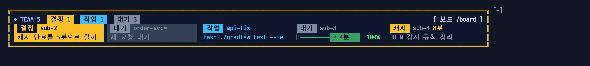

이럴 때: 세션 여러 개를 돌리다 자리로 돌아왔을 때, 누가 나를 기다리는지(노란 막대)와 누가 끝났는지(초록 막대)를 먼저 봅니다.

- 머리줄: 세션 수, 결정 대기 수(노란 블록), 작업중 수(파란 블록), 대기 수(회색 블록), 지금 도는 보조 에이전트 수(`보조 n`), `[ 보드 /board ]` 버튼을 보여 줍니다. 개수가 0인 블록은 숨깁니다.
- 칸마다 이름 앞에 상태 배지가 있습니다. 배지는 모두 폭이 6칸입니다. 그래서 모든 칸에서 이름이 같은 위치에서 시작합니다.
- 결정 대기 칸은 노란색입니다. 이 칸은 질문을 보여 줍니다.
  - 질문은 묻는 줄 가운데 마지막 줄 한 줄로 줄입니다. 그 줄이 `어느 쪽으로 할까요?` 처럼 대상 없이 일반적이면, 그 앞의 번호 항목 제목을 잇습니다 (예: `캐시 만료 시간 · 배포 시점`). 결정 기록과 카드의 `결정` 줄도 같은 요약을 씁니다.
- 할 일이 있는 칸은 [진행 막대](#진행-막대)를 보여 줍니다. 칸이 좁으면 경로선으로 대신합니다. 할 일이 없는 칸은 지금 하는 일을 보여 줍니다.
- `*` 표시는 이 세션입니다.
- 이 세션의 칸은 상태가 바뀌면 바로 바뀝니다. 다른 세션의 칸은 3초마다 상태 파일을 읽어 바뀝니다.
- 팀 창을 한 줄로 보려면 `/board band line` 을 입력하세요. 원래 모양으로 돌리려면 `/board band hud` 를 입력하세요.

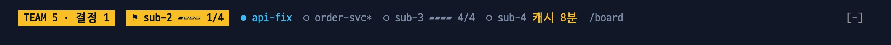

이럴 때: 창 높이가 낮아 입력창 위에 두세 줄을 내주기 아까울 때 씁니다.

| 배지 | 색 | 뜻 |
|---|---|---|
| `결정` | 반전색 (칸 전체가 노란색). 세션이 하나일 때는 노란 배지 | 결정 대기 |
| `실패` | 빨강 | 숨은 실패 |
| `작업` | 파랑 | 작업중 |
| `캐시` | 노랑 | 쉬는 세션의 캐시가 10분 이하로 남음. 이름 뒤에 남은 분(예: `8분`)을 보여 줍니다. |
| `대기` | 회색 | 대기 |
| `zz` | 테두리색 바탕, 흐린 글자 | 3분 넘게 소식이 없음 |

팀 창은 세션 수와 화면 폭에 맞춰 모양을 바꿉니다.

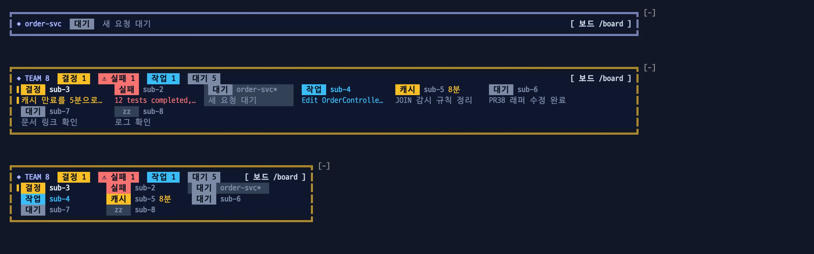

| 세션 | 모양 |
|---|---|
| 1개 | 한 줄: 이름, 상태 배지, 질문·실패·진행 막대·지금 하는 일 중 하나. `/board band solo off` 로 숨깁니다. |
| 여러 개 | 칸마다 두 줄: 상태 배지·이름 / 질문·실패·진행 막대. 넘치면 두 줄까지 줄을 바꿉니다. |
| 많거나 화면이 좁을 때 | 칸마다 한 줄: 상태 배지·이름 |
| 그래도 넘칠 때 | 중요한 세션부터 보여 줍니다. 나머지는 `+k 더 · /board` 로 표시합니다. |

보이는 순서는 결정 대기 > 숨은 실패 > 이 세션 > 작업중 > 대기 > 소식 없음입니다.

### 진행 막대

할 일이 있는 칸의 둘째 줄입니다. `/board` 카드의 `진행` 줄도 같은 막대입니다.

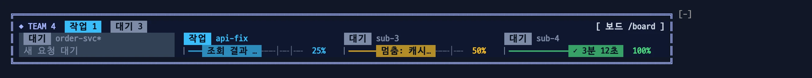

이럴 때: 노란 `멈춤` 은 일을 하다 멈춘 세션입니다. 중단했거나 오류로 끝났으니 들어가서 이어 가라고 하거나 정리합니다.

```
 작업  devflow-sub*
▏━━━━━━ 2단계: 설치… ╌╌╌│╌╌╌│╌╌  50%
```

- `▏` 막대의 왼쪽 끝입니다. 위 줄의 상태 배지와 막대를 나눕니다.
- `━` 끝낸 몫, `╌` 남은 몫, `│` 단계 경계입니다.
- 칩: 지금 단계입니다. 상태색을 한 단계 어둡게 칠해, 상태색 그대로인 배지와 구분합니다. `theme` 팔레트는 색을 섞을 수 없어 상태색 그대로 칠합니다.
- 끝의 `%` 는 칩과 같은 상태색 굵은 글자입니다.

| 칩 | 색 | 뜻 |
|---|---|---|
| `<단계>` | 파랑 | 작업중 |
| `? <단계>` | 노랑 | 결정 대기. 다 끝난 계획이면 `? 질문 대기` |
| `멈춤: <단계>` | 노랑 | 일이 멈췄는데 진행 중 단계가 남음 (중단·오류로 끝난 턴). 진행 중 단계 없이 남은 단계만 있으면 남은 첫 단계 |
| `✕ <단계>` | 빨강 | 숨은 실패 |
| `✓ <걸린 시간>` | 초록 | 다 끝남 |

- 중단·오류로 끝난 계획은 다음 턴이 계획 없이 일하는 동안에도 `멈춤` 으로 둡니다. 새 계획 보고가 오면 바로 새 막대로 바뀝니다.
- 걸린 시간은 끝난 마지막 요청에서 그 턴이 끝날 때까지입니다. 요청 없이 끝난 턴(`!` 명령에 Claude가 답한 턴 등)은 세지 않습니다.
- 턴이 도는 동안 입력창 위 Spinner 줄은 `2/4 <단계>` (지금 단계의 순번/전체)를 보여 줍니다. 끝난 계획이면 Claude Code 기본 문구를 그대로 둡니다.

## 세션 이름

team-board는 아래 순서로 세션 이름을 정합니다. 같은 폴더에서 여러 세션을 열어도 이름으로 구분합니다.

1. `/board name 이름` 으로 정한 이름
2. Claude Code 세션 이름: `claude --name 이름` 또는 `/rename 이름`
3. 워크트리의 브랜치 이름
4. 폴더 이름

- `/rename` 으로 바꾼 이름은 바로 반영합니다.
- `claude --name` 이름은 찾을 때까지 15초마다 확인합니다.
- 이름이 같으면 `order-svc·2`, `order-svc·3` 처럼 번호를 붙입니다.

## 보드

`/board` 를 입력하면 보드가 열립니다. 보드가 열리면 키보드 입력이 보드로 갑니다.

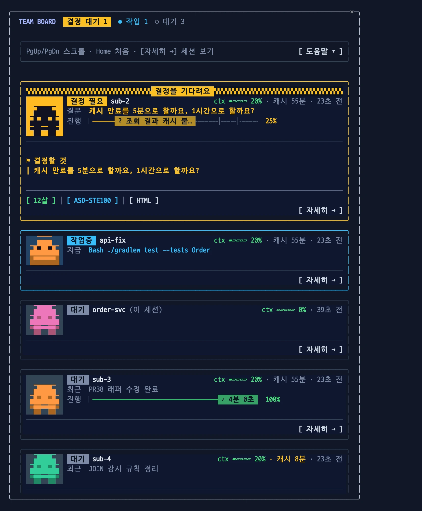

이럴 때: 팀 창의 한 줄로는 모자랄 때, 세션마다 질문 전문·지금 하는 일·진행을 카드로 펼쳐 봅니다. 결정 대기 카드에서 바로 설명 탭(12살·ASD-STE100·HTML)을 열 수 있습니다.

| 키 | 동작 |
|---|---|
| Tab | 다음 버튼으로 이동 |
| Enter | 버튼 누르기 |
| PgUp / PgDn, 마우스 휠 | 스크롤 |
| Home | 맨 위로 |
| Esc | 닫기 |

| 명령 | 동작 |
|---|---|
| `/board help` | 명령 목록과 예시를 보여 줍니다. 입력창에 `/board ` 를 치면 `[세션 \| name \| band \| sound \| fail \| help]` 힌트가 보입니다. |
| `/board` | 전체 보기: 세션마다 요청, 지금 하는 일, 진행률, 진행 중인 할 일, 최근 결정, 결정 대기 질문 |
| `/board sub-2` | 자세히 보기: 할 일 목록, 보조 에이전트 목록, 결정 기록 전체(질문 → 답), 흐름(요청 → 질문 → 결정 → 완료), 최근 편집 파일 |
| `/board name sub-1` | 이 세션의 표시 이름을 바꿉니다. 다음 세션에도 유지합니다. |
| `/board band off` / `on` | 팀 창을 끕니다 / 켭니다. 다음 세션에도 유지합니다. |
| `/board band hud` / `line` | 팀 창 모양: 칸(기본) / 한 줄 |
| `/board band solo off` / `on` | 세션이 하나일 때 팀 창을 숨깁니다 / 보입니다. 기본은 보입니다. |
| `/board fail` | 숨은 실패 보고서: 명령, 실패 흔적, 실패 코드를 가린 구문 |
| `/board fail on` / `off` / `clear` | 숨은 실패 감지를 켭니다 / 끕니다 / 이 세션의 표시를 지웁니다. |
| `/board sound on` / `off` / `test` | 결정 대기 음성 알림을 켭니다 / 끕니다 / 미리 듣습니다. 기본은 켜짐입니다. |

`[ 자세히 → ]` 와 `[ ← 전체 보기 ]` 버튼으로 두 보기를 오갑니다.

### 흐름 복사

자세히 보기의 흐름 줄은 버튼입니다. 누르면 그 줄의 원문 전체(요청, 답, 질문, 직접 쓴 결정 답)를 클립보드에 복사하고 `복사함` 을 띄웁니다. 복사하지 못하면 `복사 못 함: <이유>` 를 띄웁니다.

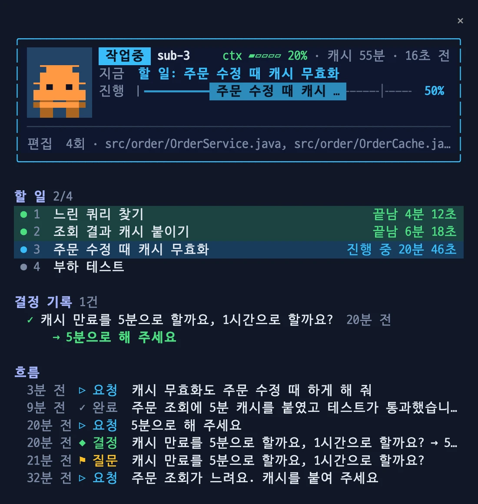

이럴 때: 자리를 비운 사이 그 세션에서 무엇을 요청했고 무엇이 정해졌는지 따라잡습니다.

- 할 일 띠의 `끝남` 과 `진행 중` 옆에 걸린 시간을 붙입니다: 앞 단계가 끝난 때(첫 단계는 계획의 첫 보고)부터 그 단계가 끝났다고 보고된 때까지. 진행 중은 지금까지. work-plan 보고를 따라갈 때만 보이고, 여러 단계를 한 번에 끝냈다고 보고하면 뒤 단계는 시간 없이 `끝남` 만 보입니다.
- 원문은 줄바꿈을 지키고 10,000자까지 담습니다. 비밀값으로 보이는 문자열은 가립니다.
- 원문은 `<세션 id>.flow` 에 따로 두고, 12시간이 지나면 비웁니다. 그보다 오래된 줄과 AskUserQuestion 결정·중단·실패 줄은 화면에 보이는 100자 줄을 복사합니다.

### 카드

패널 폭이 56칸 이상인 터미널에서 카드는 아래 모양입니다.

```
╭──────────────────────────────────────────────────────────────╮
│ ▚▚▚▚▚▚▚▚▚▚▚▚▚▚▚▚▚ 결정을 기다려요 ▚▚▚▚▚▚▚▚▚▚▚▚▚▚▚▚▚▚           │  ← 결정 대기 카드에만
│ ▐ ▐▌ ▌ 결정 필요 sub-2                    ctx ▰▱▱▱▱ 4%     │
│ ▐ ▐▌ ▌ 결정   PR38 착수 시점을 정해 주세요                       │  ← 왼쪽: 상태 픽셀 아이콘
│ ▐ ▗▖ ▌ 진행   ▏━━━━━ ? PR38 래퍼 ╌╌╌│╌╌╌╌  50%                │  ← 진행 막대
╰──────────────────────────────────────────────────────────────╯
```

- 아이콘: `!` 결정 대기 · `→` 작업중 · `✓` 대기 · 물결 소식 없음
- 진행 막대는 [팀 창의 것](#진행-막대)과 같습니다. 폭이 모자라면 경로선으로 대신합니다: `●` 끝낸 할 일 · `◉` 지금 할 일 · `○` 남은 할 일 · `◎` 도착. 할 일이 많으면 지금 할 일 근처만 보이고 양 끝은 `…` 로 줄입니다.
- 테두리 색은 상태를 나타냅니다: 노랑 결정 대기 · 빨강 숨은 실패 · 파랑 작업중 · 회색 대기.
- `ctx` 막대 색은 컨텍스트 사용량을 나타냅니다: 초록 · 노랑 50% 이상 · 빨강 80% 이상.
- 데스크톱 앱, `theme` 팔레트, 좁은 패널에서는 아이콘 없이 글자로만 카드를 그립니다.

좁은 패널(Orca 도크 등)에서는 카드 머리줄을 한 줄로 지킵니다. 배지는 줄이지 않고 이름만 줄입니다(최소 8칸). 폭이 모자라면 `(이 세션)` 대신 `*`, 그다음 ctx 막대 → `· 몇 초 전` → 캐시 → ctx 순으로 뺍니다. 곧 끝나는 캐시(경고)는 ctx 보다 오래 남깁니다. 결정 카드의 탭 줄은 탭(과 그 `↻`) 단위로 줄을 바꿉니다.

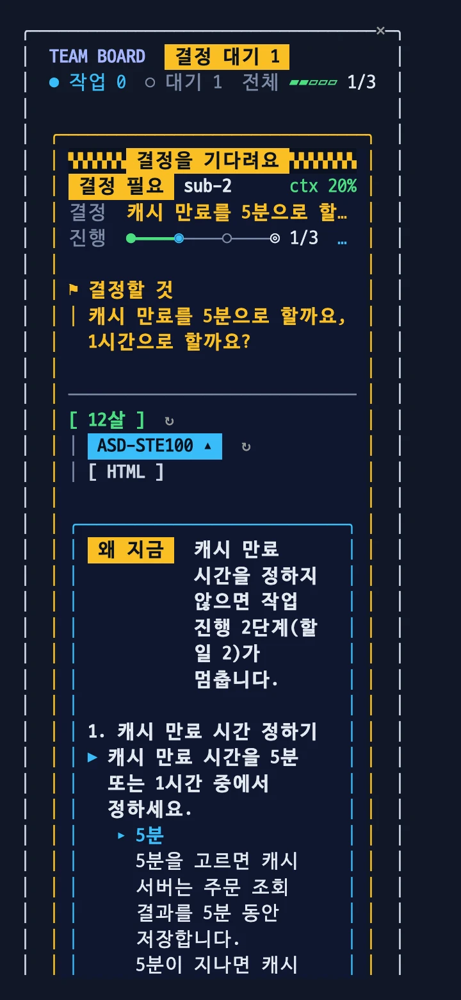

## 12살 버전 설명

결정 대기 카드 아래에 설명 탭이 있습니다. 탭마다 Haiku를 1회 호출해 따로 만듭니다. 줄 끝의 `[ HTML ]` 은 [HTML 페이지](#html-페이지)를 요청합니다.

```
[ 12살 ▴ ] ↻ │ [ ASD-STE100 ] ↻ │ [ HTML ]
```

- 탭을 누르면 그 설명을 만들어 탭 아래 상자에 보여 줍니다. 상자는 하나이고, 고른 탭의 설명만 보입니다.
- 이미 만든 탭을 누르면 모델을 다시 부르지 않고 바로 바꿉니다. 열려 있는 탭을 다시 누르면 상자를 접고 폅니다(`▴`/`▾`).
- `↻`(재생성)는 그 탭의 설명을 새로 받습니다. 만든 탭에만 보이고, 만드는 중에는 숨깁니다. 평소에는 흐리게, 초점이 가면 진하게 보입니다.
- 고른 탭은 색 바탕 배지로, 안 고른 탭은 `[ ]` 안의 색 글자로 보입니다. 12살은 초록, ASD-STE100 은 파랑이고, 상자 테두리도 고른 탭 색입니다.

두 탭 모두 상자 맨 위에 ` 왜 지금 ` 한 줄을 둡니다. 지금 이 결정이 없으면 무엇이 멈추는지를 씁니다. 0.17 전에 만든 설명에는 이 줄이 없습니다.

12살 탭은 결정 항목마다 아래 내용을 정리합니다.

- 비유
- 선택지별 ASCII 흐름 그림
- 앞선 결정과의 맥락(◆)
- 세션 제안(★)
- 먼저 정할 것 (12살 탭에만 있습니다)

그 세션의 앞선 결정, 진행 상황, 질문 직전 대화도 맥락으로 함께 보냅니다.

- 질문 직전 대화: 결정을 묻는 세션이 결정 대기가 될 때 직전 3턴(사용자 글 기준)의 사용자 글과 Claude 글을 상태 파일에 적어 둡니다. 글마다 400자까지, 도구 결과·질문 원문·플러그인이 보낸 요청은 빼고 담습니다. 결정에 답하면 지웁니다.
- 설명은 보드를 연 세션이 만들기 때문에 다른 세션의 대화를 이 상태 파일로 받습니다. 상태 파일은 `~/.claude/team-board/` 아래에만 있습니다.
- 맥락이 길어진 만큼 Haiku 입력이 늘어납니다(실세션 약 1천~1.2천 자). `[ HTML ]` 요청도 같은 만큼 길어집니다.

```
1. PR38 착수 시점 결정
   비유  숙제 1을 하다가 숙제 2도 시작할지, 1을 끝낸 뒤 시작할지
   ▸ 리뷰 후 시작
     [ 자료 10장 수정 ] → [ 수정 완료 확인 ]
     → [ PR38 착수 ]
     └ 겹침 없이 안전하지만 조금 늦어요
   ◆ 맥락  앞서 release 만 push 하기로 함
   ★ 제안  리뷰 후 시작 (10장과 코드가 겹침)
```

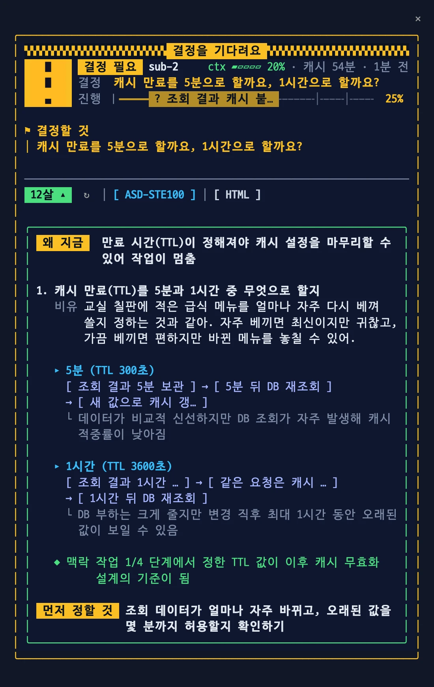

- 흐름 그림은 모델이 아니라 mod가 그립니다. mod가 한글 폭을 계산하므로 상자가 어긋나지 않습니다.
- 패널이 넓으면 `┌──┐ → ┌──┐` 상자로 그립니다. 패널이 좁으면 `[ ] → [ ]` 칩으로 그립니다.

### ASD-STE100 기준 설명

ASD-STE100 탭은 결정 항목을 ASD-STE100 기준 문장으로 씁니다. ASD-STE100 은 항공 정비 문서용 제어 언어입니다. Andrej Karpathy 의 팁을 따랐습니다: LLM 에게 ASD-STE100 으로 설명해 달라고 하면 읽기 쉽고, 규격이 엄격하면 "80% 수준"으로 완화합니다.

- 한국어로 씁니다. 능동태, 한 문장에 지시 하나, 조건을 앞에("X 이면 Y 하세요"), 같은 대상은 같은 이름, 전문용어 유지, 비유·꾸밈말 없음.
- 한 문장 25어절 이내는 이 mod 가 정한 값입니다. 규격의 한도(절차문 20단어, 서술문 25단어)는 영어 단어 기준입니다.
- 문장을 역할별 세로 목록으로 보여 줍니다: `▶` 정할 것, `▸ <선택지>` 그 선택지를 고르면 일어나는 일, `★` 세션 제안. ASD-STE100 은 서식을 정하지 않고("It does not regulate formatting"), 복잡한 글에는 세로 목록을 권합니다(Rule 4.3).
- 선택지 이름은 모델이 한 번 주고, mod 가 이름 칸과 문장에 같은 이름으로 씁니다(같은 대상은 같은 이름, Rule 1.11).

```
1. PR11 작업 시점
▶ PR11 의 작업 시점을 정하세요.
   ▸ 이번 주  이번 주를 고르면 PR11 을 지금 갱신합니다.
   ▸ 다음 주  다음 주를 고르면 현재 작업을 먼저 끝냅니다.
★ 세션은 이번 주를 제안합니다.
```

- 0.14 까지 만든 설명은 예전처럼 `·` 목록으로 보입니다.

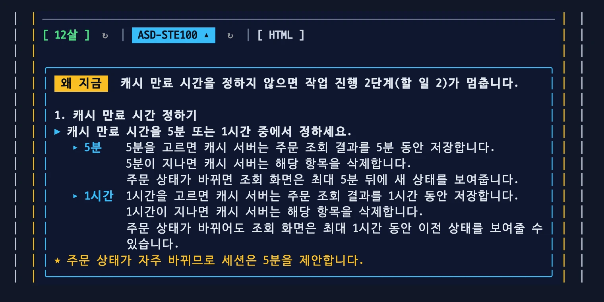

### HTML 페이지

`[ HTML ]` 을 누르면 보드를 연 세션의 Claude 에게 결정을 설명하는 HTML 페이지를 만들어 claude.ai Artifact 로 발행해 달라고 요청합니다. Claude 는 링크를 답합니다.

- 요청은 그 세션의 턴 1회입니다. 그 세션의 모델(예: Opus)을 쓰고, 대화에 요청과 답이 남습니다. 세션이 작업 중이면 끝난 뒤 시작합니다.
- 요청에는 결정 원문과 그 세션의 맥락(받은 요청, 진행, 앞선 결정, 질문 직전 대화)이 들어갑니다. 결정은 내리지 말고 작업을 이어 가지 말라고 함께 적습니다.
- 질문 하나에 한 번 요청합니다. 누른 뒤에는 버튼 대신 `HTML 요청함` 이 보이고, 질문이 바뀌면 다시 버튼이 나옵니다.
- 보드를 연 세션도 결정을 기다리는 중이었다면, 요청 턴이 끝난 뒤(중단 포함) 그 결정 대기로 돌아갑니다.
- Artifact 도구가 없는 세션이면 Claude 가 그렇다고 답합니다.

## 숨은 실패

숨은 실패는 exit 0으로 끝났지만 출력에 실패 흔적이 있는 Bash 명령입니다.

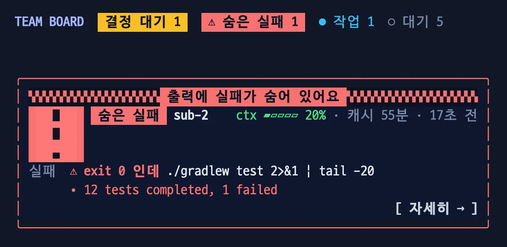

`./gradlew test 2>&1 | tail -30` 처럼 파이프로 출력을 자르면 테스트가 실패해도 exit 0이 됩니다. 이때 Claude는 실패를 "통과"로 보고할 위험이 있습니다.

team-board가 숨은 실패를 찾으면 아래와 같이 알립니다.

- Claude에게: 도구 결과에 메모를 붙입니다. 메모는 성공으로 보고하기 전에 확인하라고 요청합니다. 파이프나 `|| true` 가 실패 코드를 가렸으면 `set -o pipefail` 을 권합니다. 같은 명령을 다시 실행하면 표시가 저절로 지워진다는 것도 알립니다.
- 사람에게: 그 세션의 칸에 빨간 `실패` 배지와 실패 줄을 보여 줍니다. 예: `12 tests completed, 1 failed`. 머리줄에 `⚠ 실패 n` 을 보여 줍니다. 카드에 빨간 주의 띠를 그립니다. 다른 탭의 팀 창에도 보입니다.

### 잡는 것

- Gradle: `BUILD FAILED`, `> Task … FAILED`, `n tests completed, m failed`
- Maven: `Tests run: …, Failures: n`, `BUILD FAILURE`
- JUnit: `… > 테스트() FAILED`
- Kotlin·Java 컴파일 오류
- Spring: `APPLICATION FAILED TO START`, `Caused by: …Exception`
- npm·Python 오류, bun 요약(`2 fail`), `command not found`

아래 항목은 "확인 필요"로 보드에만 표시합니다. 이 표시는 다른 명령의 실패 표시를 덮지 않습니다.

- 건너뛴 테스트
- 실행된 테스트 없음: `No tests found for given includes`
- Maven `Tests are skipped.`: 명령에 `skipTests` 나 `skipITs` 가 있으면 표시하지 않습니다.

### 무시하는 것

- 읽기만 하는 단계로만 된 명령: `grep`, `cat`, `tail`, `sort`, `uniq`, `cut`, `sed`(`-i` 없이), `fold`, `xargs grep`, `git log/diff/rev-parse`, `git -C <경로> …`, `pwd`, `docker logs`, `kubectl logs` 등. `/bin/ls` 처럼 경로를 붙여도 같습니다. `echo x && ./gradlew test` 처럼 다른 단계가 섞이면 판정합니다.
  - 반복·조건 구문(`for f in …; do …; done`, `if [ -f x ]; then …; fi`)은 건너뛰고 안쪽 명령으로 판정합니다.
  - 출력을 파일로 쓰는 단계(`git show x > f`, `>> f`)는 읽기 전용으로 보지 않습니다. `2>&1`, `> /dev/null` 은 괜찮습니다.
- 통과 요약: `0 failed`, `ok=1 skipped=0`, `tests 52 failures 0`
- 정규식 소스 코드 줄(`(?:`, `\b`, `pattern: /` 가 든 줄)에 있는 실패 문구. 감지 규칙 같은 코드를 출력한 경우입니다.
- 읽기 도구가 파일이 없다고 알린 줄: `ls x 2>&1` 의 `No such file or directory`
- `File "…"` 줄이 뒤따르지 않는 `Traceback` 한 줄
- team-board 상태 파일(`.claude/team-board/`)을 다시 출력하는 명령

### 저장과 지우기

- 저장하는 명령과 실패 흔적에서 비밀 값을 `***` 로 가립니다. 대상: token·password 변수, `Authorization` 헤더, URL 비밀번호, `sk-`·`ghp_` 같은 토큰
- 같은 명령이 실패 흔적 없이 다시 실행되면 표시를 지웁니다. 출력이 없어도 지웁니다. `|| true` 처럼 실패 코드를 가리는 명령은 출력이 있을 때만 지웁니다.
- 같은 명령인지는 앞 두 낱말로 판단합니다. 예: `./gradlew test --tests X` → `./gradlew test`
- 둘째 낱말이 `run`, `-m`, `exec` 이면 세 낱말로 판단합니다. 예: `npm run lint`, `python -m pytest`
- 앞의 `cd`, `echo` 같은 단계는 건너뜁니다.
- 영어 출력만 판정합니다. Bash 도구만 봅니다.

## 같은 파일 겹침

같은 저장소에서 도는 두 세션이 1시간 안에 같은 파일을 고치면 알립니다.

- `/board` 머리줄에 `⚠ 겹침 <파일 수>` 칩, 두 세션의 카드에 `겹침  ⚠ src/order.ts · sub-2 12분 전` 줄을 보입니다. 여러 개면 가장 최근 것과 `외 n건`.
- 나중에 고친 세션의 Claude에게 그 편집 결과에 한 줄을 붙입니다: 어느 세션이 언제 고쳤는지, `git diff` 로 확인하라는 말. 같은 파일·같은 세션은 한 번만 알립니다.
- 파일은 저장소 루트 기준 경로로 비교합니다. 다른 폴더의 같은 이름 파일은 겹침이 아닙니다.
- Edit, Write, NotebookEdit 만 봅니다. Bash 로 고친 파일(`sed -i`, 리다이렉트)은 보지 않습니다.
- 소식 없는 세션(3분 넘게 기록 없음)과 끝난 세션은 빼고 봅니다.

## 음성 알림

macOS에서만 동작합니다. 기본은 켜짐입니다.

- 세션이 결정을 20초 넘게 기다리면 "띵동" 소리를 냅니다. 이어서 "sub-2 세션이 결정을 기다립니다"라고 한 번 말합니다.
- 질문이 나온 탭에서 바로 답하면 소리를 내지 않습니다.
- 기다리는 세션만 말합니다. 탭이 여러 개여도 한 번만 들립니다.
- 한국어 목소리 Yuna를 씁니다. Yuna가 없으면 기본 목소리로 읽습니다. 이때 한국어 발음이 어색합니다.
- Yuna를 받으려면 macOS 시스템 설정 → 손쉬운 사용 → 읽기 및 말하기 → 시스템 목소리에서 한국어(Yuna)를 내려받으세요.
- `/board sound test` 로 소리를 확인하세요.

## 보조 에이전트

세션이 띄운 서브에이전트(Agent 도구), 워크플로 에이전트, 팀원을 보여 줍니다. 턴은 끝났지만 보조가 아직 도는 세션은 ` 대기 ` 가 아니라 ` 보조 ` 배지와 `보조 n개 기다리는 중` 으로 보여, 멈춘 세션과 구별합니다.

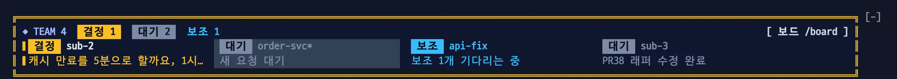

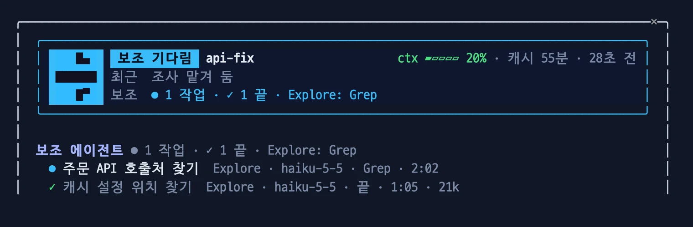

- 팀 창 머리줄: 팀 전체에서 지금 도는 수 `보조 n`. 0이면 숨깁니다.
- 카드: 보조 에이전트마다 한 줄 `↳ 1 설명 (모델)  지금 도구  시간`. 도는 것이 먼저, 3개가 넘으면 마지막 줄을 `↳ +k 보조 k개 · n개 끝남` 으로 줄입니다. 보조 에이전트가 있을 때만 보입니다.
- 좁은 창에서는 시간을 남기고 설명을 줄이고, 그래도 모자라면 모델을 빼고 긴 도구 글을 줄입니다.
- `/board <세션>`: 에이전트마다 한 줄. `● 설명  종류 · 모델 · 지금 도구 · 경과 · 토큰`. 끝나면 `✓`, 오류·중단이면 `✗`.
- 끝난 에이전트는 사람이 다음 프롬프트를 보낼 때까지 남습니다. 작업 알림으로 시작한 턴에는 지우지 않습니다.
- 토큰은 그 에이전트의 요청마다 입력·캐시 읽기·캐시 쓰기·출력을 더한 값입니다. 비용(달러)은 보여 주지 않습니다.
- 서브에이전트의 도구 호출은 메인 세션의 `지금` 줄을 덮지 않습니다.
- 엔진 이벤트(`agent.spawn`, `tool.call`, `turn.step`, `turn.complete`)와 3초마다 `$.agent.list()` 로 따라갑니다. 모델을 부르지 않아 토큰이 들지 않습니다.
- 한 세션에 12개까지 기록합니다. 넘치면 끝난 것부터 지웁니다.
- 원격(`isolation: "remote"`) 에이전트는 로컬 기록이 없어 시작만 보입니다. 워크플로 에이전트는 테스트로만 확인했습니다.

## 프롬프트 캐시 남은 시간

- 보드의 세션 줄에서 `ctx` 옆에 `캐시 42분` 처럼 보입니다.
- 쉬는 세션의 캐시가 10분 이하로 남으면 칸의 배지가 노란 `캐시` 로 바뀝니다. 이름 뒤에 남은 분(예: `8분`)을 노란 글자로 보여 줍니다.
- `/board band line` 의 한 줄 띠는 `캐시 n분` 으로 보여 줍니다.
- 이 시간 안에 다시 요청하면 대화 앞부분을 캐시에서 싸게 읽습니다.
- 마지막 메인 스레드 모델 요청부터 1시간을 셉니다. 1시간은 Claude Code 구독 세션의 캐시 수명입니다.
- 서브에이전트 요청은 세지 않습니다.
- compact나 `/clear` 뒤에는 다음 요청까지 표시하지 않습니다.
- 아래 경우에는 남은 시간을 알 수 없습니다.
  - CLAUDE.md, 도구 목록, effort가 바뀌어 캐시가 깨진 경우
  - API 키처럼 5분 캐시를 쓰는 환경
- 아이디어는 [cache-watch](https://github.com/ishuagrawal/cache-watch)와 [cache-tax](https://github.com/karanb192/cache-tax)에서 얻었습니다. 코드는 새로 썼습니다.

## 색 바꾸기

`palette` 설정은 `night`(기본), `aurora`, `theme` 중 하나입니다. `night` 와 `aurora` 는 어두운 터미널용입니다. `theme` 은 Claude Code 테마 색을 따릅니다. 밝은 배경에서는 `theme` 을 쓰세요.

| `night` (기본) | `aurora` | `theme` (밝은 테마) |
|---|---|---|
|  | 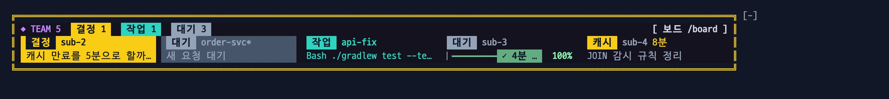 |  |

이럴 때: 터미널 배경이 밝으면 `theme` 으로 바꿉니다. 어두운 배경에서 파랑이 잘 안 보이면 `aurora` 를 써 봅니다.

```bash
claude plugin configure team-board@devflow-mods      # 또는 /plugin → Installed → team-board → Configure
```

## 무엇이 기록되나

- 진행 현황: Claude의 할 일 도구(TaskCreate, TaskUpdate, TodoWrite)를 따라갑니다. [work-plan](../work-plan/README.md)을 함께 설치하면 그 계획 보고도 따라갑니다.
  - 답으로 끝난 턴이면 질문으로 끝났어도 남은 단계를 완료로 그립니다. 중단·오류로 끝난 턴은 보고된 그대로 두고 `멈춤` 으로 보입니다.
  - `막힘` 단계는 `막힘: <제목>` 으로 보입니다.
  - compaction 뒤 새 보고 전에는 지금 하는 일이 `할 일(압축 전): …` 으로 보입니다.
  - 두 곳에서 모두 보고하면 나중에 쓴 쪽이 보입니다.
- 결정 ①: AskUserQuestion의 질문과 사용자가 고른 답
- 결정 ②: 답변 끝에서 결정을 요청하면 사용자의 다음 요청을 그 결정의 답으로 기록합니다.
  - 결정 요청으로 보는 문장: "정해 주세요", "할까요?", "진행해도 되면 알려 주세요" 등
  - 결정 요청으로 보지 않는 문장:
    - "문제가 있으면 알려 주세요", "필요하면 해당 저장소 경로를 알려 주세요" 같은 조건문 (조건과 "알려 주세요" 사이 낱말 세 개까지)
    - "다른 뜻이었다면 알려 주세요" 같은 맺음말
    - "무엇을 도와드릴까요?" 같은 인사
    - "확인해 주세요"
    - `?` 로 끝나는 제목
- 흐름: 요청, 질문, 결정, 완료, 중단, 숨은 실패를 최근 12개까지 기록합니다.
- 요청과 결정의 답으로 기록하는 입력: 터미널 입력창, Remote Control, `claude -p`, Agent SDK
- 기록하지 않는 입력:
  - 작업 알림
  - 다른 세션이 보낸 메시지
  - IDE 등 같은 사용자 소켓으로 들어온 입력
  - Slack 호출
  - 플러그인이 보낸 프롬프트

## 다른 mod와 함께 쓰기

입력창 위 영역(`AbovePrompt`)을 `next(e)` 없이 그리는 mod가 체인에서 team-board보다 앞에 있으면 팀 창이 보이지 않습니다. 이때도 team-board는 계속 기록합니다. 예: Anthropic 샘플 `token-weather`, `replay-theater`.

team-board를 맨 앞에 두려면 `~/.claude/settings.json` 에 아래 설정을 넣으세요.

```json
"prependPlugins": ["team-board@devflow-mods"]
```

- 이 설정은 managed settings가 없는 기기에서만 적용됩니다. Team·Enterprise 로그인에서는 적용되지 않습니다.
- 적용 여부는 `claude --debug-file <파일>` 로그에서 `hooks module team-board@devflow-mods loaded (… tier prepend)` 줄로 확인하세요.
- prompt-coach 0.3.0 이상이 질문의 답을 기다리면 그 세션은 결정 필요(`prompt-coach: <질문>`)로 보입니다. 다듬은 글을 입력창에 넣거나 그만두면 앞 상태(대기, 또는 기다리던 Claude 의 질문)로 돌아갑니다. prompt-coach 가 없으면 아무 일도 없습니다.
- 비밀 값을 가리는 mod(예: `secret-redactor`)는 도구 결과만 가립니다. team-board가 저장하는 실패 명령 원문은 그 mod가 가리지 않습니다.

## 알아둘 것

- 상태는 `~/.claude/team-board/<레포>/` 에 세션마다 JSON 파일로 저장합니다.
- 상태 파일에는 요청, 질문, 답 원문이 평문으로 들어갑니다. 이 폴더가 동기화 폴더가 아닌지 확인하세요. 오래된 파일은 지워도 됩니다.
- 결정 ②는 결정 요청 다음의 첫 요청을 답으로 봅니다. 그 사이에 다른 이야기를 하면 그 이야기가 답으로 기록됩니다.
  - 그 요청을 답도 도구 호출도 없이 중단(Esc)하면 기록을 지우고 같은 질문의 결정 대기로 돌아갑니다. 다음 요청이 답이 됩니다. 도구를 쓰거나 답을 쓰기 시작한 뒤의 중단은 기록을 그대로 둡니다.
- `/board` 로 연 상황판이 화면에 그려지지 않으면 "팀 상황판을 그리지 못했어요: <이유>" 를 보여 줍니다. 이유는 Claude Code 가 준 문구 그대로입니다. Orca 의 좁은 창에서 상황판이 보이지 않다가 창을 넓히니 열린 사례가 있습니다.
- 권한 확인 창(Allow?)에서 멈춘 세션은 mod가 알 수 없습니다. 이 세션은 "작업중"으로 보입니다.
- Linux·Windows 터미널에서는 소리가 나지 않습니다. Claude Code가 그 환경의 재생기를 쓰지 않기 때문입니다.
- `/clear` 뒤에도 세션은 보드에 "대기"로 남습니다.
  - 결정 기록과 `/board name`·`/rename` 이름은 유지합니다.
  - 결정 대기 질문과 할 일 진행률은 비웁니다.
  - 흐름에 `⟲ 대화 지움` 을 남깁니다.
- 화면은 3초마다 갱신합니다.
- 탭을 `/exit` 없이 닫으면 3분 뒤 그 세션을 흐리게 표시합니다. 같은 폴더에 같은 이름의 새 세션이 열리면 숨깁니다. 12시간 뒤에는 모두 숨깁니다.
- 플러그인이 갱신되거나 다시 로드되어도 같은 세션의 이름, 할 일, 결정 기록은 이어집니다.
- 할 일 진행률은 그 세션에서 만든 할 일만 셉니다. 다른 세션에서 넘어온 할 일 목록은 세지 않습니다.
- 숨은 실패는 출력 글자로 판단합니다. 실패 메시지를 일부러 출력하는 테스트에서는 잘못 걸릴 수 있습니다. 이때는 `/board fail clear` 로 지우거나 `/board fail off` 로 끄세요.
- 숨은 실패 표시는 상태 파일에 저장됩니다. 탭을 다시 열어도 남습니다.
