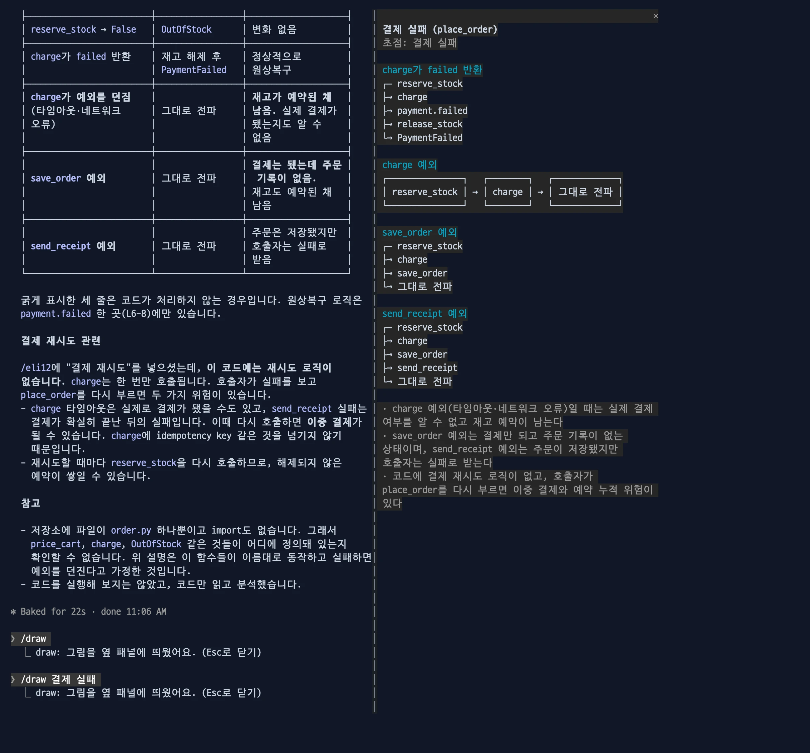

# draw

`/draw` 를 입력하면 직전 답변에 든 흐름(작업 순서, 호출 경로, 갈래)을 옆 패널에 그림으로 보여 줍니다. 상자 이름은 원문 낱말과 식별자를 그대로 씁니다.

```
rkm2aws
┌─ rkmService.decrypt(data)
├→ kmsService.encrypt(평문)
├→ KMS Encrypt(SYMMETRIC_DEFAULT)
├→ URL-safe Base64
└→ ResponseObject{data}
```

- 긴 설명을 여러 세션에서 동시에 읽을 때 흐름을 놓치는 문제를 줄이려고 만들었습니다.
- `/eli12` 는 설명을 12살 버전으로 바꿉니다. `/draw` 는 설명을 바꾸지 않고 그 안의 흐름만 그립니다.
- 다른 mod가 없어도 혼자 동작합니다.


이럴 때: 표와 문단이 긴 답을 받은 뒤, 답은 그대로 두고 순서와 갈래만 옆에서 한눈에 봅니다.

```bash
claude plugin marketplace add yeochul-jeon/devflow-mods
claude plugin install draw@devflow-mods
```

## 동작

- `/draw` 는 직전 답변 전체를, `/draw <낱말>` 은 그 낱말에 관한 흐름만 그립니다.



이럴 때: 답 중 한 주제(예: 결제 실패)의 흐름만 따로 보고 싶을 때 낱말을 붙입니다.
- 직전 답변을 Haiku 에 한 번 보내 흐름을 JSON 으로 받고, 그림은 mod 가 그립니다. 한글 폭(2칸)을 계산해 그리므로 상자가 어긋나지 않습니다.
- 흐름은 4개, 흐름마다 단계는 6개까지입니다. 이름이 짧아 한 줄에 다 들어가면 상자를 가로로, 아니면 한 단계에 한 줄씩 세로로 그립니다. 긴 이름은 자르지 않고 다음 줄로 이어 씁니다.
- 그림에 담지 못한 조건이나 되돌아가는 흐름은 그림 아래 `·` 줄에 적습니다.
- 메인 대화에는 `그림을 옆 패널에 띄웠어요.` 한 줄만 남습니다. Esc로 패널을 닫습니다.

## 효과와 비용

2026-10-18 측정 (Haiku, `claude -p`, 실제 대화의 긴 답변 10개: 일직선 7, 갈래 2, 포함 1, 같은 프롬프트로 2회):

| | 결과 |
| --- | --- |
| 상자 이름이 원문 낱말·식별자에서 나온 비율 | 99.3%, 99.3% |
| 원문 단계를 빠뜨리거나 순서를 바꾸지 않은 답변 | 9/10, 9/10 (일직선·갈래 9개는 9/9) |
| 원문에 없는 흐름을 지어냄 | 0, 0 (애매 1) |
| 상자 어긋남·폭 넘침 (40·58칸) | 0줄 |
| 요청 | 실행마다 Haiku 1회, 메인 대화 요청 0 |
| 토큰 | 입력 2.5천~4.2천, 출력 1.2천~5.5천 (생각 포함) |
| 걸린 시간 | 6~22초 |

- 판정은 사람이 정한 규칙으로 읽어서 했습니다(모델 채점 아님).
- 순서 없는 묶음(포함 관계)은 그리지 않고 아래 줄에 적습니다. 위 실패 1건이 이것입니다.
- 짧게 쓰라고 시키면 단계가 빠졌습니다(같은 표본에서 6/9~7/9). 그래서 상자 이름이 원문 문장만큼 길어지는 것을 받아들였습니다. 평균 25칸, 긴 것은 170칸 넘게 여러 줄로 이어집니다.

## 알아둘 것

- 그림은 모델이 고른 흐름입니다. 원문과 다르면 원문을 믿으세요.
- 직전 답변은 12,000자까지 보냅니다.
- 조직 관리 환경(Team, Enterprise)에서 Haiku 가 막혀 있으면 `/draw: 모델 호출 실패 (…)` 가 나옵니다.
- Claude Code 2.1.302 에서 시험했습니다.
