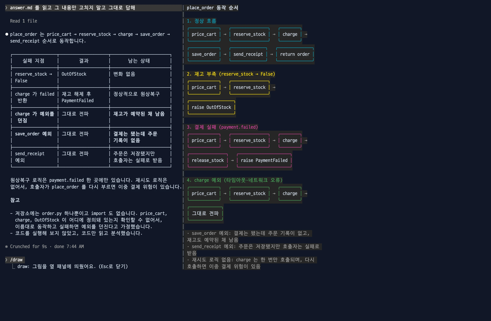
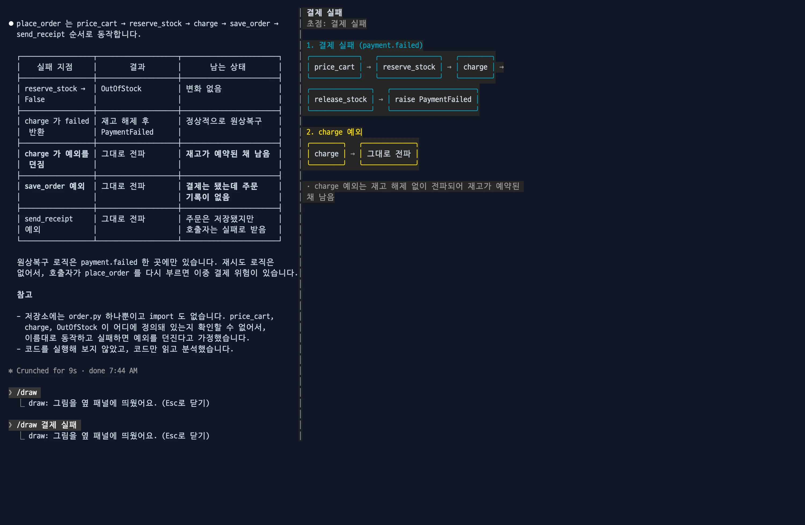

# draw

`/draw` 를 입력하면 직전 답변에 든 흐름(작업 순서, 호출 경로, 갈래)을 옆 패널에 그림으로 보여 줍니다. 상자 이름은 원문 낱말과 식별자를 그대로 씁니다.

```
1. release
╭──────╮   ╭──────╮   ╭────────╮   ╭────────────╮
│ bump │ → │ test │ → │ commit │ → │ release.sh │ →
╰──────╯   ╰──────╯   ╰────────╯   ╰────────────╯
╭─────────╮
│ install │
╰─────────╯
```

- 긴 설명을 여러 세션에서 동시에 읽을 때 흐름을 놓치는 문제를 줄이려고 만들었습니다.
- `/eli12` 는 설명을 12살 버전으로 바꿉니다. `/draw` 는 설명을 바꾸지 않고 그 안의 흐름만 그립니다.
- 다른 mod가 없어도 혼자 동작합니다.



이럴 때: 표와 문단이 긴 답을 받은 뒤, 답은 그대로 두고 순서와 갈래만 옆에서 한눈에 봅니다.

```bash
claude plugin marketplace add yeochul-jeon/devflow-mods
claude plugin install draw@devflow-mods
```

## 동작

- `/draw` 는 직전 답변 전체를, `/draw <낱말>` 은 그 낱말에 관한 흐름만 그립니다.



이럴 때: 답 중 한 주제(예: 결제 실패)의 흐름만 따로 보고 싶을 때 낱말을 붙입니다.
- 직전 답변을 Haiku 에 한 번 보내 흐름을 JSON 으로 받고, 그림은 mod 가 그립니다. 한글 폭(2칸)을 계산해 그리므로 상자가 어긋나지 않습니다.
- 흐름은 4개, 흐름마다 단계는 6개까지이고 흐름 이름 앞에 1. 2. 3. 4. 를 붙입니다. 단계 상자는 패널 폭에 맞춰 여러 줄로 접습니다. 패널보다 긴 이름은 자르지 않고 상자 안에서 줄을 바꿉니다.
- 데스크톱 앱·VS Code·모바일에서는 흐름마다 단계 상자를 Svg 그림 한 장으로 그립니다. 앱 테마를 따라가지 않는 이미지라 상자 바탕을 옅은 색으로 칠하고 글자를 진하게 둡니다(밝은 테마·어두운 테마 공통). 터미널은 글자 상자 그대로입니다.
- 옆에 붙는 패널은 늘 상자 그림이고, 넘치는 흐름은 패널을 눌러 화살표로 스크롤해 봅니다. 프롬프트 위에 붙는 패널(80×24 에서는 6줄)에 흐름이 다 안 보이면 제목을 빼고 흐름마다 색칠한 단계 이름을 화살표로 이은 줄로 줄여 그립니다. 이때 메모는 개수만 보이고, 패널을 키우면 보입니다.

```
1. 행이 충분할 때  maxRows 읽기 → team-board → next-steps → prompt-coach
2. 행이 모자랄 때  maxRows 읽기 → 바깥 mod 가 순서를 정한다 →
                   넘친 줄은 위쪽만 보인다
```
- 그리는 동안 경과 초와 막대를 보입니다. 막대는 평소 걸리는 시간(15초)에 가득 차고, 그보다 오래 걸리면 가득 찬 채 초만 올라갑니다.
- 그림에 담지 못한 조건이나 되돌아가는 흐름은 그림 아래 `·` 줄에 적습니다.
- 메인 대화에는 `그림을 옆 패널에 띄웠어요.` 한 줄만 남습니다. Esc로 패널을 닫습니다.

## /draw-seq (실험)

`/draw-seq` 는 직전 답변에서 누가 누구에게 무엇을 보내고 돌려받는지(주고받음)를 시퀀스 다이어그램으로 옆 패널에 보여 줍니다. `/draw-seq <낱말>` 은 그 낱말에 관한 주고받음만 그립니다. 참여자는 4개, 메시지는 10개까지입니다.

```
client               order-svc          payment-svc
  |                      |                      |
  | 1 POST /orders       |                      |
  |--------------------->|                      |
  |                      | 2 charge             |
  |                      |--------------------->|
  |                      | 3 결제 결과          |
  |                      |<.....................|
  |                      |--+ 4 주문 저장       |
  |                      |<-+                   |
  | 5 201 Created        |                      |
  |<.....................|                      |
```

- 화살표 위에 번호와 메시지 이름을 적습니다. 응답은 점선(`....`), 자기 자신에게 하는 일은 `--+` 고리로 그립니다.
- 패널이 40칸보다 좁으면 번호 목록으로 그립니다.

  ```
  A client   B order-svc
  C payment-svc
   1 A > B  POST /orders
   2 B > C  charge
   3 C > B  결제 결과
   4 B      주문 저장
   5 B > A  201 Created
  ```
- 프롬프트 위 패널에서 줄이 모자라면 메시지를 이어 붙인 줄로 줄이고, 마지막 줄에 못 보인 메시지 수를 적습니다.
- 데스크톱 앱, VS Code, 모바일에서는 생명선 그림을 Svg 한 장으로 그립니다. 메시지 이름마다 옅은 바탕을 깔아 밝은 테마와 어두운 테마 둘 다에서 읽힙니다.
- 기본 모델은 Haiku, effort 는 high 입니다. `/config` 의 draw 설정에서 바꿉니다.
  - `seqModel`: 모델 별칭이나 id (예: `sonnet`). 측정에서 Sonnet 은 한 번에 Haiku(effort high)의 약 13배 비용이었습니다.
  - `seqEffort`: `low`, `medium`, `high`. `max` 는 받지 않습니다(측정 1회에 6분, 생각 토큰 9만 개).
- 주고받음이 없는 답변(혼자 하는 작업 순서, 목록)이면 그리지 않고 이유를 보입니다. 이때는 `/draw` 를 쓰세요.
- 모델이 참여자 목록에 없는 이름으로 메시지를 적으면 그 메시지는 빼고, 뺀 개수를 그림 아래 `·` 줄에 적습니다. 10개를 넘는 메시지도 같습니다.

실험 기능인 이유 (2026-11-15~16 측정, `claude -p`, 실제 대화의 주고받음 답변):

| | 결과 |
| --- | --- |
| Haiku 기본, 정답 항목을 모두 맞힌 실행 | 9/32 (엄격 기준, 두 판정 같음). 느슨한 기준(Codex 판정) 19/32. 맞힌 실행은 대부분 원문에 이미 ASCII 그림이 있던 답변 |
| 재시도와 조회를 빠뜨리던 답변 (Haiku effort 기본 → high) | 0~1/4 → 3~4/4 |
| 역할을 헷갈리던 답변 (참여자 4명) | Haiku high, Sonnet 모두 고치지 못함 |
| Haiku effort high 한 번 | 중앙 18초, 정가 약 0.002달러 |

- 판정은 에이전트와 Codex 가 따로 했고 사람이 확인하지 않았습니다. 실패 유형마다 답변 하나로 쟀습니다.
- 참여자가 4명이면 생명선 사이가 약 15칸이라 메시지 이름이 여러 줄로 접히고 그림이 길어집니다.
- 참여자가 혼자 하는 단계(저장, 상태 변경)가 가끔 빠집니다. 데스크톱 앱에서 1회 빠졌고, 같은 답변을 `claude -p` 로 4회 돌렸을 때는 빠지지 않았습니다. 이 단계를 넣으라는 문장을 프롬프트에 더해 재 보니 다른 표본이 나빠져서 넣지 않았습니다(2026-11-16).

## 효과와 비용

2026-10-18 측정 (Haiku, `claude -p`, 실제 대화의 긴 답변 10개: 일직선 7, 갈래 2, 포함 1, 같은 프롬프트로 2회):

| | 결과 |
| --- | --- |
| 상자 이름이 원문 낱말·식별자에서 나온 비율 | 99.3%, 99.3% |
| 원문 단계를 빠뜨리거나 순서를 바꾸지 않은 답변 | 9/10, 9/10 (일직선·갈래 9개는 9/9) |
| 원문에 없는 흐름을 지어냄 | 0, 0 (애매 1) |
| 상자 어긋남·폭 넘침 (40·58칸, 0.1.0 그림) | 0줄 |
| 요청 | 실행마다 Haiku 1회, 메인 대화 요청 0 |
| 토큰 | 입력 2.5천~4.2천, 출력 1.2천~5.5천 (생각 포함) |
| 걸린 시간 | 6~22초 |

- 판정은 사람이 정한 규칙으로 읽어서 했습니다(모델 채점 아님).
- 순서 없는 묶음(포함 관계)은 그리지 않고 아래 줄에 적습니다. 위 실패 1건이 이것입니다.
- 짧게 쓰라고 시키면 단계가 빠졌습니다(같은 표본에서 6/9~7/9). 그래서 상자 이름이 원문 문장만큼 길어지는 것을 받아들였습니다. 평균 25칸, 긴 것은 170칸 넘게 여러 줄로 이어집니다.

## 알아둘 것

- 그림은 모델이 고른 흐름입니다. 원문과 다르면 원문을 믿으세요.
- 직전 답변은 12,000자까지 보냅니다.
- 조직 관리 환경(Team, Enterprise)에서 Haiku 가 막혀 있으면 `/draw: 모델 호출 실패 (…)` 가 나옵니다.
- Claude Code 2.1.302 에서 시험했습니다. `/draw-seq` 는 2.1.325 터미널에서 시험했고, 데스크톱 앱 모습은 아직 확인하지 않았습니다.
