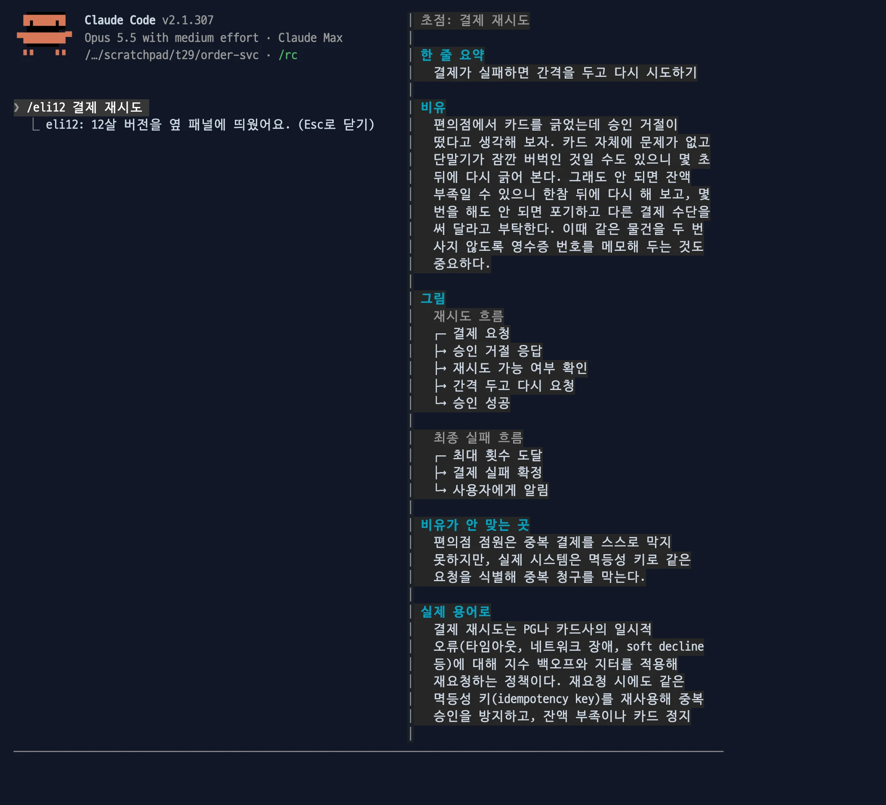

# eli12

어려운 설명을 12살도 이해하게 다시 풀어 줍니다. 두 가지가 들어 있습니다.

- 자동 스킬 `explain-simply`: Claude 가 처음 보는 개념이나 얽힌 흐름을 설명할 때, 그 부분에만 일상 비유와 텍스트 그림을 넣습니다.
- `/eli12` 명령: 직전 답변을 옆 패널에 12살 버전(한 줄 요약, 비유, 흐름 그림, 기억할 것)으로 다시 풉니다.


이럴 때: 긴 기술 답을 받았는데 핵심이 잘 안 잡힐 때, 답은 그대로 두고 옆에서 쉬운 버전을 봅니다.

- `/draw` 는 설명을 바꾸지 않고 그 안의 흐름만 원문 낱말로 그립니다. `/eli12` 는 설명을 쉬운 말과 비유로 바꿉니다.
- 다른 mod가 없어도 혼자 동작합니다.

```bash
claude plugin marketplace add yeochul-jeon/devflow-mods
claude plugin install eli12@devflow-mods
```

## 동작

- `/eli12` 는 직전 답변 전체에서 어려운 부분을, `/eli12 <부분>` 은 그 부분을 중심으로 풉니다.
- 직전 답변이 없으면 적은 주제 자체를 설명합니다. 이때는 "기억할 것" 대신 "비유가 안 맞는 곳" 과 "실제 용어로" 를 보여 줍니다.



이럴 때: 처음 듣는 개념(예: 결제 재시도)을 대화 시작 전에 먼저 감 잡고 싶을 때 주제만 적습니다.

- 직전 답변을 Haiku 에 한 번 보내 내용을 JSON 으로 받고, 그림은 mod 가 그립니다. 한글 폭(2칸)을 계산해 그리므로 상자가 어긋나지 않습니다.
- 흐름은 2개, 흐름마다 단계는 6개까지입니다. 단계 이름이 한 줄에 다 들어가면 상자를 가로로, 아니면 한 단계에 한 줄씩 세로로 그립니다.
- 메인 대화에는 `12살 버전을 옆 패널에 띄웠어요.` 한 줄만 남습니다. Esc로 패널을 닫습니다.

## 비용

- `/eli12` 한 번에 Haiku 1회. 출력 한도는 8000 토큰입니다. 원문 1.1만 자로 잰 출력은 대부분 400~700 토큰이었고, 생각이 길어진 1회는 2870 토큰이었습니다.
- 자동 스킬은 별도 호출 없이 Claude 의 답 안에서 동작합니다.

## 알아둘 것

- 자동 스킬의 그림은 Claude 가 대화에 직접 그리므로 한글 줄에서 상자가 어긋날 수 있습니다. 패널(`/eli12`)의 그림은 어긋나지 않습니다.
- 모델 답이 JSON 형식이 아니면 패널에 이유를 보여 줍니다. 다시 `/eli12` 하세요.

## 개발

```bash
claude plugin test ./eli12
claude plugin eval ./eli12   # evals/ 의 스킬 케이스 3개
```
