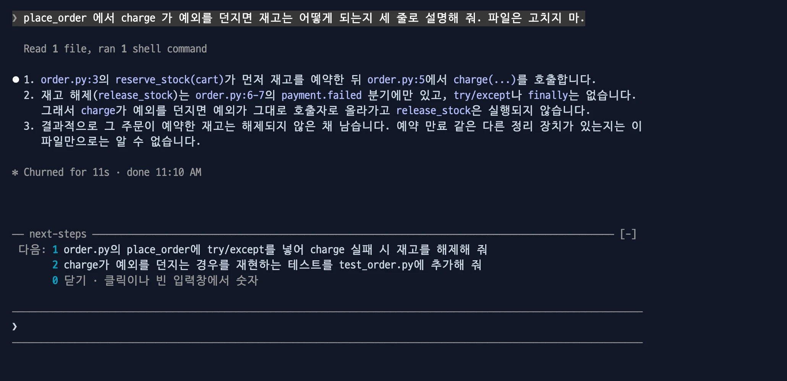
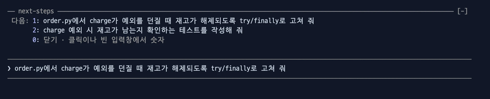
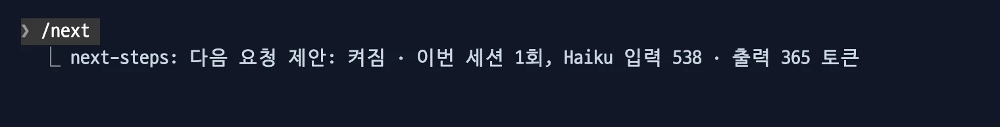

# next-steps

Claude의 답변이 끝나면 입력창 위에 다음에 보낼 만한 요청을 3개까지 보여 줍니다. 숫자를 누르면 그 요청이 입력창에 초안으로 들어갑니다.



이럴 때: 답을 읽고 "그다음 뭘 시키지?" 를 직접 쓰기 전에, 흐름상 이어질 요청을 골라 고쳐 보냅니다.

- 다른 mod가 없어도 혼자 동작합니다.

```bash
claude plugin marketplace add yeochul-jeon/devflow-mods
claude plugin install next-steps@devflow-mods
```

## 동작

- 답변이 끝나면 `다음: 1 … 2 … 3 …` 을 보여 줍니다. 목록 위의 흐린 가로줄 `── next-steps ──`이 위 대화와 목록을 나눕니다.
- 빈 입력창에서 숫자를 누르면 그 요청이 초안으로 들어갑니다. 고치거나 Enter로 보내세요. 자동으로 보내지 않습니다.
- 제안 줄을 클릭하면 그 요청이 입력창의 커서 자리에 들어갑니다. 쓰던 글은 남습니다. 마우스를 올린 줄에는 음영이 생깁니다. 클릭은 fullscreen 터미널에서만 동작합니다.
- `0` 은 목록을 닫습니다.
- 제안은 대화 언어를 따릅니다. 파일 이름, 명령, 식별자는 그대로 둡니다.



이럴 때: 제안이 거의 맞지만 조금 다를 때, 숫자로 넣은 뒤 고쳐서 보냅니다.

## 명령

| 명령 | 동작 |
| --- | --- |
| `/next` | 이번 세션 사용량(호출 수, Haiku 입력·출력 토큰)을 보여 줍니다. |
| `/next off` · `/next on` | 끄고 켭니다. 다음 세션에도 유지됩니다. |



이럴 때: 제안에 드는 Haiku 비용이 얼마인지 확인하고, 필요 없으면 `/next off` 로 끕니다.

## 비용과 주의

- 메인 스레드의 답변이 끝날 때마다 Haiku를 1회 호출합니다.
- 보내는 내용: 최근 대화 6개를 800자씩, 최신 답변 2000자. 출력은 200토큰 이하입니다.
- 20자 미만의 답변, 서브에이전트의 턴, 백그라운드 에이전트가 실행 중일 때는 호출하지 않습니다.
- 목록이 보이는 동안 빈 입력창에 `1` 로 시작하는 글을 치면 첫 글자가 제안을 고릅니다. 이때는 `0` 으로 목록을 먼저 닫으세요.
- prompt-coach 가 질문을 띄우면 목록을 닫습니다. 숫자는 prompt-coach 질문의 답이 됩니다.
- 아이디어는 [hamzafer/claude-code-mods](https://github.com/hamzafer/claude-code-mods)의 next-steps(MIT)에서 얻었습니다. 코드는 새로 썼습니다.
