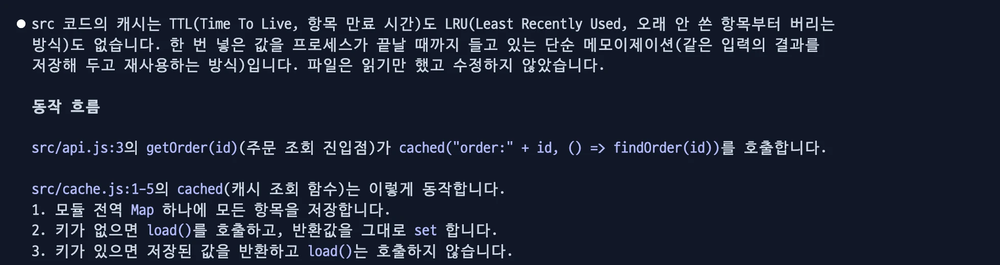

# plain-terms

Claude가 작업 번호, 코드 이름, 약어를 대화에서 처음 쓸 때 한 번 짧게 풀어 쓰게 합니다. 30분 넘게 자리를 비웠다 돌아오면 다시 풉니다. 화면에 그리는 것은 없습니다.

```
tsc(TypeScript 타입 검사기) 오류 3개 …
E1(work-plan의 Enterprise 설치 확인): …
```



이럴 때: 여러 세션의 답을 번갈아 읽다 보면 약어나 함수 이름이 무엇이었는지 놓칩니다. 처음 나온 자리에서 바로 풀어 주어 위로 다시 올라가 찾지 않아도 됩니다.

- 여러 세션을 동시에 볼 때 `T6`, `G4b`, `STE`, `scanGen` 같은 말이 무엇인지 놓치는 문제를 줄이려고 만들었습니다.
- 다른 mod가 없어도 혼자 동작합니다.

```bash
claude plugin marketplace add yeochul-jeon/devflow-mods
claude plugin install plain-terms@devflow-mods
```

## 동작

- 규칙을 대화의 첫 프롬프트에 한 번 붙입니다. `/clear` 뒤, `/resume` 뒤, compaction 뒤 첫 프롬프트에 다시 붙입니다. 슬래시 명령에는 붙이지 않고 다음 일반 프롬프트에 붙입니다.
- 규칙 내용 (0.2.0):
  - 작업 번호(HANDOFF·문서·다른 세션에서 가져온 것 포함), 코드 식별자·설정·작업 중 만든 이름, 약어를 **대화에서 처음** 쓸 때 한 번 푼다. 답마다 다시 풀지 않는다.
  - 풀이는 그것이 무엇인지·무엇을 하는지를 적는다. `T7(작업 7번)` 처럼 번호를 되풀이하는 것은 풀이가 아니다.
  - 괄호 풀이 `scanGen(…)` 와 목록식 정의 `- F4: …` 둘 다 된다. 목록·범위·표에 번호가 몰려 나오면 그 아래에 범례 한 줄(`D24 = …, D25 = …`)을 단다.
  - 식별자·경로·명령은 원문 그대로 둔다. 코드 블록 안은 풀지 않는다. API, JSON, HTML, CSS, CLI, UI, URL, PR, git 은 풀지 않는다. 규칙을 답에서 언급하지 않는다.
  - 원문은 [hooks/rule.ts](hooks/rule.ts) 에 있습니다.
- 사람이 보낸 직전 프롬프트(터미널 입력·Remote Control·`claude -p`, 슬래시 명령 포함)에서 30분 넘게 지나 들어온 프롬프트에는 「자리를 비웠으니 이번 답에서 작업 번호·코드 이름을 처음 쓸 때 다시 풀라」는 한 줄을 붙입니다. 돌아와서 슬래시 명령을 먼저 쳤거나 다른 mod 가 첫 보내기를 막았으면 다음에 실제로 들어가는 프롬프트에 붙입니다. Claude 가 한 턴을 30분 넘게 일한 뒤 보낸 프롬프트도 같은 조건이라 붙습니다. 작업 알림, 예약 실행, 다른 세션이 보낸 메시지는 시각을 옮기지 않고 알림도 받지 않습니다.
- 서브에이전트에는 붙이지 않습니다.

## 효과와 비용

### 0.2.0 (2026-11-15 측정)

Opus 5.5, Claude Code 2.1.325, 다른 mod 없이(`--setting-sources project --strict-mcp-config`), 한 프로세스에서 6턴 대화(`--input-format stream-json`, 규칙은 대화에 한 번). 작업 번호·코드 이름이 든 HANDOFF.md 와 소스 파일 하나를 읽고 요약·표·설명·순서 제안·되묻기를 시켰습니다. 0.1.1 과 0.2.0 을 3회씩 돌렸습니다.

| | 0.1.1 | 0.2.0 |
| --- | --- | --- |
| 대화에서 처음 나온 작업 번호·코드 이름 중 풀이가 붙은 것 (정규식, 번호 되풀이 풀이는 뺌) | 60개 중 72% | 61개 중 72% |
| 같은 판정에 범례 줄(`D25 = …`)과 `T5 완료: …` 꼴 목록식 정의를 풀이로 더한 값 (두 판에 같은 규칙) | 60개 중 75% (빠진 것 15) | 61개 중 89% (빠진 것 7) |
| 앞 답에서 이미 푼 용어를 뒤 답에서 다시 푼 횟수 | 105 | 24 (−77%) |
| 번호만 되풀이한 풀이 (`T5 (작업 5번)`) | 22 | 0 |
| 답 길이 (대화당 6턴 합) | 4,631자 | 4,008자 (−13%) |
| 첫 요청 입력 | 19,488 토큰 | 19,648 토큰 (+160, 규칙 727자 → 1,248자) |

- 0.2.0 은 처음 나온 용어를 조금 더 풀고(75% → 89%), 되풀이 풀이와 번호만 되풀이한 풀이는 크게 줄었습니다. 표본이 작으니(3회씩) 값은 대략으로 보세요.
- 비교 대상은 0.1.1 입니다. 규칙 없는 판은 이번에 돌리지 않았습니다(0.1.0 때 기준값은 아래 표).
- 30분 알림은 한 줄 252자이고 돌아온 첫 프롬프트에만 붙습니다. 효과는 재지 않았습니다.
- 실제 대화 기록(2026-10-16 ~ 11-15, 세션 약 800개, 정규식 판정)에서 0.1.1 의 괄호 풀이 비율은 첫 답 35%, 그 뒤 20~26% 였습니다. 풀리지 않은 것의 32%가 목록·범위·표에 몰려 나온 번호였습니다. 0.2.0 의 범례 줄은 이것을 겨냥합니다. 위 시험에서는 0.2.0 3회 중 2회가 첫 답(요약)의 목록에서 범례 줄(`D25 = …`, `P3 = …`)을 썼고, 표(2번째 질문)와 번호가 이어진 문단(4번째 질문)에서는 쓰지 않았습니다.

### 0.1.0 (2026-10-18 측정)

Opus 5.5, `claude -p`, 다른 mod 없이:

| | 규칙 없음 | 규칙 | 
| --- | --- | --- |
| 처음 나온 용어 중 풀이가 붙은 비율 (흔한 약어 제외) | 평소 답변 20개: 20.8% / 시험 프롬프트 5개: 44.9% | 시험 프롬프트 5개: 81.1% |
| 답변 길이 (시험 프롬프트 5개 평균) | 1,420자 | 1,584자 (+11.5%) |
| 첫 요청 입력 | | +279 토큰 |
| 요청 수 | | 늘지 않음 |

- 평소 답변 20개는 이 저장소의 실제 대화에서 뽑았습니다. 시험 프롬프트는 문서·코드를 읽고 설명하게 하는 5개이고, 각 1회씩 돌렸습니다. 프롬프트마다 길이 변화가 −5%~+31% 로 흔들리므로 값은 대략으로 보세요.
- 늘어난 길이의 약 95%는 풀이 괄호입니다.
- 규칙은 대화 기록에 남으므로 이후 요청도 같은 양을 캐시에서 다시 읽습니다. 규칙은 사용자 프롬프트 뒤에 붙어 앞부분 캐시를 깨지 않습니다.
- 마지막 줄("규칙을 답에서 언급하지 않는다")은 측정 뒤 더한 줄이고 따로 재지 않았습니다. 이 줄 없이 잰 시험에서 5개 중 2개 답이 규칙을 언급했고, 이 줄이 든 다른 문구의 시험에서는 언급이 없었습니다.

끄려면 플러그인을 끕니다.

```bash
claude plugin disable plain-terms@devflow-mods
```

## 알아둘 것

- 풀이는 모델이 붙입니다. 지나가며 쓴 식별자(`asking`, `messages()` 등)는 풀이 없이 나오기도 합니다.
- hover, compaction 같은 일상어나 mod 이름까지 풀기도 합니다.
- 조직이 관리하는 Claude Code(Team, Enterprise)에서는 compaction hook(`session.compact`)이 돌지 않아 compaction 뒤 규칙을 다시 붙이지 않습니다. 규칙은 system prompt가 아니라 프롬프트 문맥(`prompt.submit`)으로 붙이므로 조직 관리 환경에서도 붙는 것으로 예상하지만 확인하지 않았습니다.
- 0.1.x 는 Claude Code 2.1.301, 2.1.302 에서, 0.2.0 은 2.1.322, 2.1.323, 2.1.325 에서 시험했습니다.
