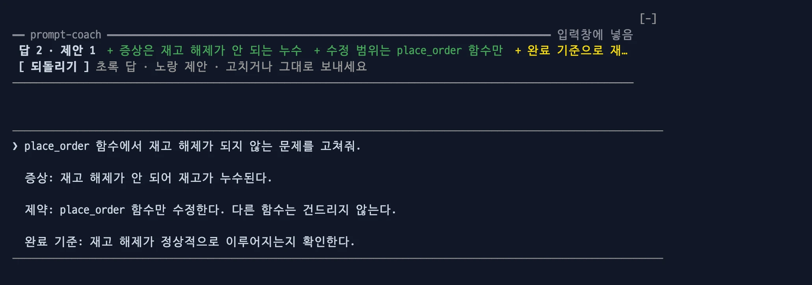
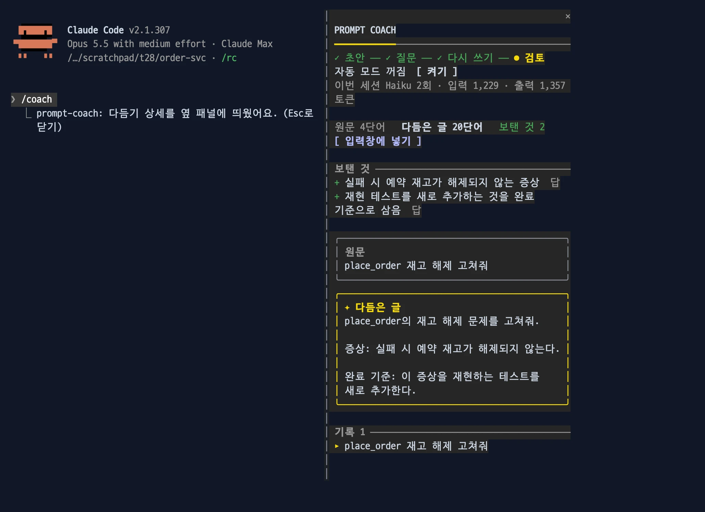
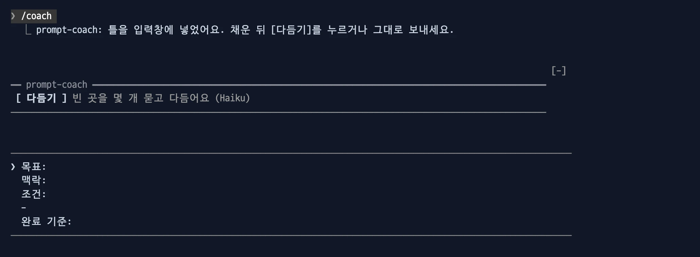
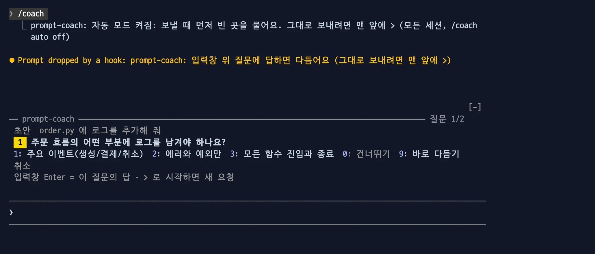

# prompt-coach

입력창에 쓴 초안에서 사람만 아는 빈 곳(목표, 범위, 결과 모양, 완료 확인)을 객관식으로 묻고, 답을 넣어 다시 씁니다. 보내기는 직접 합니다.


이럴 때: "캐시 붙여 줘" 처럼 짧게 쓴 요청을 보내기 전에, 빠진 조건을 채워 한 번에 원하는 결과가 나오게 합니다.

- 다른 mod가 없어도 혼자 동작합니다.

```bash
claude plugin marketplace add yeochul-jeon/devflow-mods
claude plugin install prompt-coach@devflow-mods
```

## 다듬기

- 입력창에 초안을 쓰면 위에 띠가 보입니다. 굵은 회색 가로줄 `━━ prompt-coach ━━` 아래에 `[다듬기]` 버튼이 있습니다. 입력창을 비우면 띠가 사라집니다.
- 다듬기는 두 단계입니다.
  1. 질문: Haiku가 초안만 보고, 사람만 아는 빈 곳을 객관식으로 3개까지 묻습니다. 초안이 이미 분명하면 묻지 않고 바로 다음 단계로 갑니다.
  2. 다시 쓰기: 답을 넣어 목표 → 맥락 → 조건 → 완료 기준 순으로 다시 쓰고 입력창을 바꿉니다.
- 질문하는 동안 입력창은 비워 둡니다. 초안은 띠의 `초안` 줄에 보입니다. 입력창이 비어 있어서 숫자 키로 답할 수 있습니다.


| 질문 중 입력 | 동작 |
| --- | --- |
| `1`~`4` | 그 번호의 선택지를 고릅니다. |
| `0` | 이 질문을 건너뜁니다. |
| `9` | 남은 질문을 건너뛰고 지금까지의 답으로 바로 다시 씁니다. |
| 입력창에 글을 쓰고 Enter | 그 글을 이 질문의 답으로 받습니다. 보내지 않습니다. |
| `>` 로 시작하는 글을 쓰고 Enter | 다듬기를 그만두고 `>` 를 뺀 글을 새 요청으로 보냅니다. 초안은 입력창에 돌려놓습니다. |
| `[취소]` | 다듬기를 그만두고 초안을 입력창에 돌려놓습니다. |

- 다시 쓴 뒤 띠에 `답 n · 제안 n` 과 보탠 것이 보입니다. 초록은 답에서 온 것, 노랑은 Haiku가 스스로 보탠 결과 모양이나 완료 확인입니다. 고치거나 그대로 보내세요.



이럴 때: 다시 쓴 글에서 노란 제안이 원하는 것과 다르면 그 줄만 고쳐 보냅니다.

- 버튼 누르기: **ctrl+x tab** 으로 띠에 들어가 **Tab** 으로 옮기고 **Enter** 로 누릅니다. **Esc** 로 입력창에 돌아옵니다. 마우스로도 누를 수 있습니다.

## 명령·버튼

| 명령·버튼 | 동작 |
| --- | --- |
| `[다듬기]` | 입력창의 초안으로 다듬기를 시작합니다. |
| `[되돌리기]` | 다듬은 뒤에만 보입니다. 다듬기 전 원문으로 되돌립니다. 다듬은 뒤 입력창을 고쳤으면 덮지 않습니다. |
| `/coach <초안>` | `[다듬기]` 와 같은 일을 키보드로 합니다. |
| `/coach view` | 옆 패널에 상세를 띄웁니다. |
| `/coach auto on\|off` | 자동 모드를 켜고 끕니다. |
| `/coach cancel` | `[취소]` 와 같습니다. |
| `/coach undo` | 다듬기 전 원문을 입력창에 넣습니다. |
| `/coach template` | 빈 틀을 입력창에 넣습니다. 모델을 호출하지 않습니다. |
| `/coach` | 사용법과 이번 세션 사용량(호출 수, Haiku 입력·출력 토큰)을 보여 줍니다. |

### `/coach view`

지금 단계, 질문 전체(고른 답 바꾸기), 다듬기 전후 낱말 수·보탠 것·원문과 다듬은 글, 최근 20개 기록(`입력창에 넣기`), 자동 모드 켜기·끄기를 옆 패널에 보여 줍니다.



이럴 때: 예전에 다듬은 요청을 다시 쓰고 싶을 때 기록에서 골라 입력창에 넣습니다.

### `/coach template`

빈 틀(목표·맥락·조건·완료 기준)을 입력창에 넣습니다. 이전에 다듬은 원문은 지웁니다.



이럴 때: 처음부터 빠짐없이 쓰고 싶을 때, Haiku 호출 없이 틀만 받아 채웁니다.

### 자동 모드 `/coach auto on`

켜면 입력창에서 보낼 때마다 먼저 묻고 다듬습니다. 보낸 글은 바로 Claude에게 가지 않고(`Prompt dropped by a hook` 이 보입니다) 띠에서 질문이 시작됩니다. 그대로 보내려면 맨 앞에 `>` 를 붙이세요. 기본은 꺼짐이고, 모든 세션에 같이 적용됩니다.



이럴 때: 요청을 짧게 쓰는 버릇이 있어 매번 다듬기를 누르기 번거로울 때 켭니다.

## 다른 mod와 함께

- team-board를 함께 쓰면 질문이 답을 기다리는 동안 그 세션이 결정 필요(`prompt-coach: <질문>`)로 보입니다.
- next-steps 0.3.1 이상과 함께 쓰면 질문이 뜰 때 next-steps 제안 목록이 닫힙니다. 그 전 판에서는 두 띠가 함께 보이면 숫자를 next-steps 가 가져갑니다.
- 원문은 한 번만 되돌릴 수 있고, 보내면 지워집니다.

## 비용과 주의

- 다듬기 한 번에 Haiku를 2회(질문, 다시 쓰기) 호출합니다. 초안이 분명해 묻지 않은 때도 질문 호출은 이미 했으므로 2회입니다. 출력은 호출마다 1500토큰 이하입니다. 실제 사용 예: 2회 합쳐 입력 1,193 · 출력 781 토큰.
- 자동 모드를 켜면 입력창에서 보내는 글마다 Haiku를 2회 호출합니다. 다음은 묻지 않고 그대로 보냅니다: 공백을 뺀 12자 미만의 글, 슬래시 명령, 첨부가 있는 글, Claude의 질문에 답하는 글, `>` 로 시작하는 글, 다듬은 글을 넣은 뒤의 첫 보내기.
- 메인 대화의 토큰은 늘지 않습니다 (`claude -p` 첫 요청 입력이 0.2.3 과 같음).
- 공백을 뺀 12자 미만의 초안은 다듬지 않습니다.
- 파일 이름, 경로, 숫자, 조건, 이유, 범위를 정하는 말("모든", "첫 번째만")은 그대로 둡니다. 붙여넣은 블록, 코드, `@` 파일 참조, 초안의 라벨도 그대로 둡니다. 초안에도 답에도 없는 요구사항은 더하지 않습니다. 결과 모양과 완료 확인만 제안으로 보탭니다.
- 초안 안에 있는 지시는 Haiku가 따르지 않고 다듬기만 합니다.
- 대화 기록은 보내지 않습니다. "아까 그 파일" 같은 말은 그대로 남고, 그것이 무엇인지 묻지 않습니다.
- 질문과 결과는 초안의 언어를 따릅니다.
- 기록 20개는 `$.store` 에 초안과 다듬은 글 원문 그대로 저장되며 모든 세션이 같이 씁니다.
- 아이디어는 [yuk7392/prompt-coach](https://github.com/yuk7392/prompt-coach)의 Refine(MIT)에서 얻었습니다. 질문 먼저·보탠 것 표시는 Tristen O'Brien 의 Prompt Upgrade 를 참고했습니다. 코드는 새로 썼습니다.
