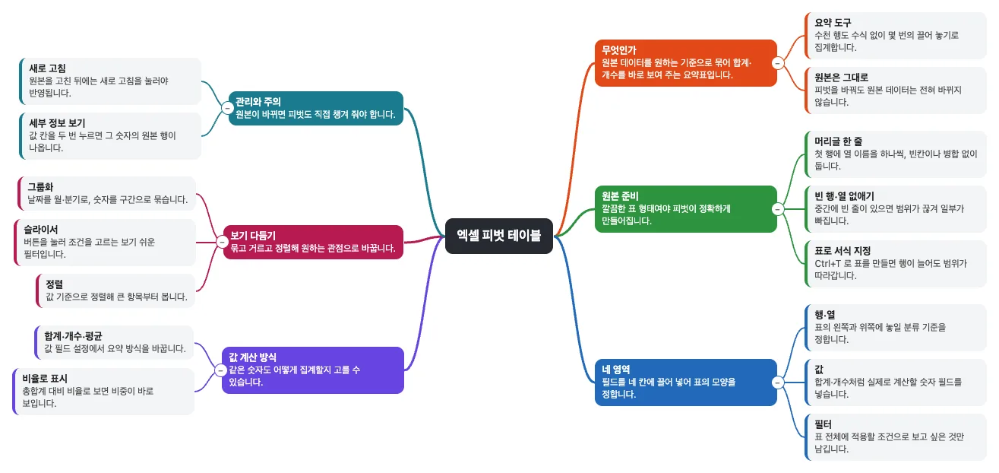

# study

주제 하나를 공부용 HTML 파일 한 장으로 만듭니다. 스킬 `study` 하나에 모드 4개가 있습니다. 직접 부를 때만 동작합니다(Claude 가 알아서 부르지 않습니다).

```bash
claude plugin marketplace add yeochul-jeon/devflow-mods
claude plugin install study@devflow-mods
```

```
/study:study <mindmap|diagram|guide|quiz> <주제> [--out <디렉터리>]
```

| 모드 | 파일 | 만드는 것 |
|---|---|---|
| `mindmap` | `mindmap.html` | 주제가 처음인 사람을 위한 마인드맵. 가운데 주제에서 색이 다른 큰 가지 5~6개가 좌우로 퍼지고, 큰 가지마다 작은 가지 2~3개. 가지를 클릭하면 아래가 숨겨지고 다시 보입니다. 가지마다 설명 한 문장. 인쇄하면 모두 펼쳐 A4 가로 한 장. |
| `diagram` | `diagram.html` | 주제를 이루는 부분(사각형)과 흐름(화살표)을 파일 안의 SVG 로 그린 그림. 사각형마다 설명 한 문장. |
| `guide` | `guide.html` | 인쇄하면 A4 한 쪽인 학습지. 꼭 알 개념 다섯, 흔히 틀리는 점 셋, 직접 풀어 볼 문제 하나. |
| `quiz` | `quiz.html` | 일하다 겪을 법한 상황을 묻는 4지선다 5문항. 정답·풀이는 클릭해야 보이고, 인쇄하면 맨 끝 «정답» 절에 모입니다. |



예:

```
/study:study mindmap 엑셀 피벗 테이블
/study:study guide 엑셀 VLOOKUP --out notes
/study:study quiz 깃 브랜치
/study:study diagram 브라우저에서 웹 페이지가 열리기까지
```

- 모드가 없거나 4개 밖이면 파일을 만들지 않고 사용법만 보여 줍니다.
- `--out` 은 인자 어디에 와도 됩니다. 없으면 현재 작업 폴더에 저장합니다. 지정한 디렉터리가 없으면 만들지 않고 멈춥니다.
- 같은 이름 파일이 있으면 덮어쓰지 않고 `mindmap-2.html` 처럼 번호를 붙입니다.
- 주제가 현재 저장소의 파일·모듈·클래스 이름이면 그 코드를 먼저 읽고, 파일 맨 아래 «근거» 줄에 읽은 경로를 적습니다.
- 모든 파일은 외부 자원(CDN, 웹폰트, 외부 이미지) 없이 파일 하나로 열립니다. 인쇄하면 접힌 것이 모두 펼쳐집니다.

## 출처

모드 4개와 각 모드의 조건은 빌더 조쉬(Builder Josh)가 공개한 «클로드로 뭐든 배우는 요청문 10개» 중 5 Mind Map, 10 Schematic, 7 Study Guide, 6 Quiz Me 에서 가져왔습니다. 요청문 원문은 옮기지 않고 조건만 이 저장소의 말로 다시 썼습니다. 그 요청문들이 기대고 있는 해외 공부법 영상의 제목·채널은 확인하지 못했습니다.

원 요청문과 다른 점:

- 모드 이름 `guide` 는 원 목록의 Study Guide 입니다(`/study:study study …` 가 헷갈려서 바꿨습니다).
- 퀴즈에서 정답을 나중에 보게 하는 조건을, HTML 에서는 «클릭해야 펼쳐짐» 과 «인쇄하면 맨 끝 정답 절» 로 옮겼습니다.
- 원 글이 결과를 HTML 로 받을 때 붙이라고 권한 조건(파일 하나, 외부 자원 없음, 인쇄 품질)은 네 모드 모두에 적용합니다.
- 그 밖의 기능(테마, 다크 모드, 그림 밖 목록, 연습 문제 풀이 등)은 더하지 않았습니다.
- 나머지 6개(ELI5, 80/20, Sticky Notes, Feynman, First Principles, Socratic)는 넣지 않았습니다. 쉽게 풀어 설명하기는 [eli12](../eli12/README.md) 가 합니다.

## 알아둘 것

- 비용: 별도 모델 호출이 없습니다. 부를 때 스킬 본문(약 280줄)이 대화에 들어가고, 파일을 쓰는 만큼 출력 토큰을 씁니다.
- 접기·펼치기와 인쇄 동작은 스킬에 고정한 CSS·스크립트 뼈대로 만듭니다. 모델은 내용만 채웁니다. 그래도 내용의 정확성은 모델 지식에 달려 있고, 스킬이 사실을 검증하지는 않습니다.
- A4 한 장은 분량 제한(개념 80자, 실수 70자 등)으로 맞춥니다. 실측에서는 한 장이었지만 주제에 따라 넘칠 수 있습니다.
- 구조도는 상자 크기를 고정하고 글자 수를 제한합니다(이름 12자, 설명 16자). 더 긴 글자는 상자 밖으로 나갈 수 있습니다.
- 파일 이름 확인은 Glob 으로 하고, Glob 도구가 없는 세션에서는 Read(첫 줄만)로 합니다. `--out` 을 줬을 때만 디렉터리 확인에 `ls -d` 를 써서, 권한 모드에 따라 Bash 승인을 한 번 묻습니다.
- 마인드맵 그림은 스킬에 고정한 스크립트(약 3.5KB)가 가지 목록을 읽어 그립니다. 모델은 좌표를 쓰지 않고 이 스크립트를 그대로 옮겨 적습니다. 그래서 0.1.0 보다 출력이 조금 늘었습니다(`claude -p` 1회씩: 0.1.0 출력 토큰 5,103·$0.47(가지 34개), 0.2.0 세 주제 출력 토큰 6,120~6,728·$0.53~$0.64(가지 22~24개); 0.2.1 은 모드 CSS·스크립트가 약 170바이트 늘었고 따로 재지 않았습니다). 화면에서는 그림이 창 폭보다 넓으면 창 폭에 맞춰 줄어듭니다. 줄이는 비율은 모두 펼친 그림 폭으로 정하므로 접고 펴도 글씨 크기가 그대로이고, 창 크기를 바꾸면 다시 맞춥니다. 아주 좁은 창에서는 그만큼 더 작아집니다. 스크립트가 꺼진 브라우저나 그리기가 실패한 경우에는 가지 목록이 그대로 보입니다.
- 인쇄 크기는 가지 수 상한(큰 가지 6, 작은 가지 3, 2단계까지)으로 맞춥니다. 긴 제목·최대 분량 시험 파일에서 축소 비율 0.77(설명 글씨 약 7pt)이었습니다. 배경색은 인쇄에도 찍히도록 했습니다(`print-color-adjust`).

## 측정

0.2.0 최종 판(2026-11-25, Claude Code 2.1.331): `claude plugin eval` 9케이스 × 3회(0.1.0 의 8케이스 + `name-taken`). 8케이스 3/3, mindmap 2/3(비용 $6.17). mindmap 의 실패 1회는 내용 판정(Haiku 2:1 FAIL)으로, 같은 파일을 같은 지시문으로 Haiku 에 다시 3번 물으니 3번 모두 «숫자 열에 글자나 빈칸이 섞이면 합계 대신 개수가 나온다» 의 «빈칸» 을 틀렸다고 했습니다. Microsoft 지원 문서(«Sum values in a PivotTable»)는 빈칸이나 숫자 아닌 값이 있으면 개수를 쓴다고 하므로 판정 쪽이 틀렸습니다. 이 실행의 마인드맵 6개는 모두 렌더 검사를 통과했습니다(축소 비율 0.79, 1쪽). Haiku 판정이 사실을 틀리게 알 수 있으니, 내용 판정이 실패하면 `--judge-model sonnet` 으로 다시 보거나 판정 이유를 확인하세요.

그 전 판(마지막 스크립트·판정 변경 전): 9케이스 × 3회에서 8케이스 3/3, mindmap 2/3 이었습니다(비용 $6.13). 실패 1회는 내용 판정(Haiku 3표 모두 FAIL)이었고, 판정 이유는 결과에 남지 않아 원인은 확인하지 못했습니다. 그 파일(길이로 특정)을 다시 읽어도 구조(큰 가지 6·작은 가지 2~3)와 내용에 뚜렷한 잘못은 없었습니다. 그래서 개수 조건을 LLM 판정에서 빼고 정규식 판정 5개(큰 가지 5~6, 작은 가지 2~3, 2단계까지)로 옮겼습니다. 이 판정들은 0.2.0 결과 10개(eval 6·실사용 3·최대 시험 파일 1)를 모두 통과시키고, 0.1.0 결과 2개(가지 수 초과)와 3단계가 있는 시험 파일 1개를 잡았습니다. 고친 뒤 mindmap 3/3(내용 판정 9표 모두 PASS, $0.99). 그 3개 파일과 eval·실사용(`claude -p`, 엑셀 피벗 테이블·운영체제·Git 브랜치 전략) 파일은 `study-mindmap-check.sh` 의 렌더 검사를 통과했습니다(축소 비율 0.77~0.80, 1쪽; 실사용 3개는 가로 간격을 줄이기 전 스크립트로 만든 것). `name-taken` 은 `--disallow-tools Glob` 으로 1회 통과했고, 기록에서 `Read(limit 1)` 두 번 뒤 `mindmap-2.html` 에 쓴 것을 확인했습니다. 실제 브라우저의 Cmd+P 인쇄 미리보기는 확인하지 않았습니다(PDF 는 CDP `Page.printToPDF` 로 확인).

0.1.0: `claude plugin eval` 8케이스(2026-11-24, 0.1.0, Claude Code 2.1.331, 케이스마다 3회): 모드 4개, `--out` 있는 디렉터리, `--out` 없는 디렉터리, 모드 없음, 평문 «구조도를 그려 줘»(스킬이 뜨지 않아야 함). 8케이스 모두 3/3 통과했습니다(비용 $4.46, 판정 모델은 기본값 Haiku). 그 전 판에서는 guide 의 내용 판정이 Haiku 로 1/3 실패했고(판정 이유는 결과에 남지 않음), 같은 판을 `--judge-model sonnet` 으로 다시 돌리면 3/3 통과했습니다. Haiku 판정은 흔들릴 수 있습니다. 평문 케이스는 스킬이 자동 호출을 막아 두었으므로 늘 통과합니다(변별력 없음). 결과 폴더(`evals/results/`)는 로컬에만 남고 저장소에 올리지 않습니다. 개수 조건은 HTML 요소의 `data-study` 표지를 정규식으로 셉니다(개념 5·실수 3·연습 1, 문항 5·답 5). 내용의 정확성은 LLM 판정입니다.

## 개발

```bash
claude plugin validate ./study
claude plugin eval ./study --runs 3 --ablation none --no-publish --scaffold --allow-tools Write 'Bash(ls:*)'
```

- `--ablation none`: 플러그인 없는 비교 쪽에는 `/study:study` 명령이 없어 비교가 뜻이 없습니다.
- `--allow-tools Write`: 파일을 써야 하는 케이스가 있어서입니다. `--scaffold`: `out-existing` 케이스가 `notes/` 를 미리 만듭니다.
- `--no-publish`: 보고서를 claude.ai 에 올리지 않습니다.

마인드맵은 그림을 스크립트가 그리므로 eval 의 정규식·LLM 판정으로는 그림이 실제로 나오는지 알 수 없습니다(eval 에는 코드 실행 판정이 없습니다). 그래서 두 가지를 더 씁니다.

```bash
python3 docs/tools/study-mindmap-graders.py --check   # eval 의 글자 일치 판정(07·08)이 SKILL.md 와 같은가. SKILL.md 를 고쳤으면 --check 없이 돌려 다시 만듭니다
docs/tools/study-mindmap-check.sh [--space <ego 공간 번호>] <mindmap.html>...
```

- `study-mindmap-check.sh`: 파일의 모드 CSS·모드 스크립트가 SKILL.md 원문과 같은지 봅니다. `--space` 를 주면 `ego-browser`(ego lite 브라우저 CLI) 의 그 공간에 새 탭을 열어 창 폭 1280px 에서 가로 스크롤 없이 들어가는지(처음 열 때, 접기·펼치기 뒤, 창을 넓혔다 좁힌 뒤, 그리고 비율이 바뀌지 않는지), 노드 수, 접기·펼치기, 인쇄 상태에서 모든 가지가 그려지는지, 축소 비율 0.75 이상, PDF 1쪽을 확인합니다. 끝나면 연 탭만 닫습니다.
- 확인할 파일은 `claude plugin eval … --keep-temp` 가 남긴 기록(`out/trace.jsonl` 의 Write 내용)이나 실제로 만든 파일입니다.
- `docs/tools/study-mindmap-fixtures/`: `max.html`(긴 제목·최대 분량, 인쇄 축소 비율), `closed.html`(접힌 가지가 인쇄에서 펼쳐지는지), `broken.html`(그리기가 실패하면 FAIL 이 나오고 목록이 보이는지 — 이 파일은 FAIL 이 정상). 시험 파일도 `study-mindmap-graders.py` 가 SKILL.md 에서 만들고 `--check` 로 맞는지 봅니다.
